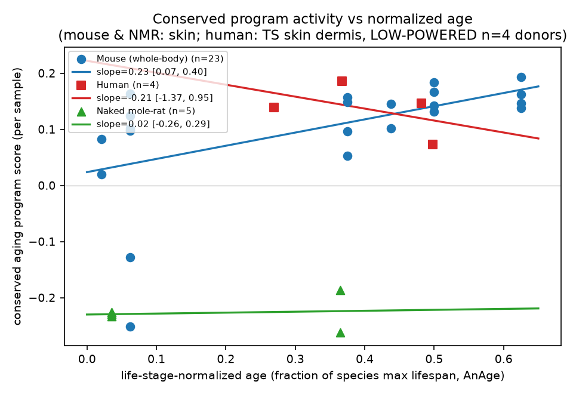

# agescape — Conserved Aging Explorer

**Cross-species single-cell aging analysis: mouse (Tabula Muris Senis) → human (attempted, documented as untestable) → naked mole-rat (longevity outlier).**

> **Status: Public release pending Reza's review — private repository.** No remote is configured.



## The honesty moment (read this first)

Two facts define this project, and both are on the first screen on purpose:

1. **The mouse atlas is sex-confounded by design.** In the TMS droplet data (245,389 cells,
   23 mice), age groups 1m/24m/30m are male-only and 21m is female-only. Every pooled analysis
   here prints the sex×age table (`results/m1-sex-age-table.csv`) next to it, and the only
   interpretable age contrast is 3m vs 18m.
2. **The human replication arm is untestable with obtainable public data — and that is a
   result, not an omission.** Tabula Sapiens v1 is an adult cohort (skin donors 33/45/59/61 y,
   n=4; lung donors 59/59/60/61 y), and the SenNet public index exposes no donor ages
   (6,820 datasets queried 2026-10-14). No conservation or divergence call is made from
   human data anywhere in this repo.

**20 minutes? Read this:** the report's [Abstract](report/conserved-aging-programs.md) and its
[Limitations](report/conserved-aging-programs.md) section (18 items).

## Key findings (every number from `results/`)

- **Aging-signal ranking (mouse):** 17 of 163 tissue×cell-type units met the pre-registered
  eligibility floor (≥3 mice, ≥50 cells per group) — all in Lung or Kidney. Top units:
  Lung::adventitial cell (55 DE genes) and Kidney::proximal convoluted tubule epithelial cell
  (53). Calibration trio on the top unit: 55 observed vs 4.6 permutation-null vs 0 sex-floor
  DE genes. (`results/m2-*.csv`)
- **Agreement with the TMS paper's own published coefficients:** 13 agree / 4 partial /
  0 disagree across the 17 powered units (Spearman ρ up to 0.866).
  (`results/m3-agreement-table.csv`)
- **Signature result:** the mouse whole-body program score (167 up / 94 down genes from the
  17 units) rises with life-stage-normalized age (**slope 0.235 [0.067, 0.403], p=0.008,
  n=23 mice** — positive control). The naked mole-rat score is flat over the tested span
  (**slope 0.017 [-0.257, 0.290], p=0.858, n=5**). The mouse-vs-NMR slope difference is
  0.218 [-0.013, 0.449], **p=0.064 — suggestive, not conclusive**; TOST equivalence at the
  pre-registered δ=25% of the mouse slope was **not** established (p=0.329); exact permutation
  p=0.818. We do not claim NMR equivalence. NMR program-gene coverage is 31%.
  (`results/m6-statistical-summary.csv`, `results/m6-gates.csv`)
- **Savina 2022 (NMR skin, *Aging*) partially reproduced:** 29 global DE genes at the paper's
  stated rule vs their reported 0 (natural-log unit-conversion caveat; 560 genes at
  FDR<0.05 & |log2FC|≥0.25). Igfbp3 is absent from the GEO count file — unverifiable.
  NMR QC: 10,251 cells vs the paper's 10,232; sample 2V dropped per the paper.
  (`results/m6-savina-reproduction.csv`)

## Repository layout

```
agescape/
├── PLAN.md / HANDOFF.md     # pre-registered decisions + operating manual
├── report/
│   └── conserved-aging-programs.md   # the full scientific report
├── notebooks/               # 01–07, committed fully executed (kernelspec: agescape)
├── scripts/
│   ├── fetch_data.py        # re-acquire all raw data (resumable, SHA-256 verified)
│   ├── verify_data.py       # checksum every raw file against data/manifest/
│   └── run_all.py           # full pipeline: notebooks 01→07, all figures + results
├── src/                     # importable utilities (IO, plotting, seed policy)
├── results/                 # golden-output CSVs — the only permitted number source
├── figures/                 # all figures, written only by notebooks
├── data/
│   ├── raw/                 # immutable inputs (gitignored)
│   ├── interim/             # pipeline checkpoints (gitignored)
│   └── manifest/            # one JSON per file: url, IDs, version, size, sha256, dates
├── notes/                   # methods registry, QC decisions, gate reports, reviews
└── environment.lock         # frozen conda environment
```

## Reproduction

```bash
conda create -n agescape --file environment.lock
python scripts/fetch_data.py     # downloads + verifies all raw data
python scripts/run_all.py        # executes notebooks 01→07 via the nbconvert gate command
```

A full recompute takes **on the order of hours** on a 12-core/49 GB machine. All stochastic
steps are seeded (seed 42); key tables in `results/` are golden outputs checked by the pipeline.

## Data manifest and checksums

Every raw file has a manifest JSON in `data/manifest/` recording URL, accession or
CELLxGENE dataset UUID + version, schema version, size, SHA-256, and download date. Sources:
TMS droplet (CELLxGENE collection `0b9d8a04-bb9d-44da-aa27-705bb65b54eb`, dataset
`48b37086-25f7-4ecd-be66-f5bb378e3aea`, version `084058cc-4f17-43ce-b14e-1278df074013`),
Tabula Sapiens Skin/Lung (CELLxGENE), NMR skin (GEO GSE152886), AnAge official export
(2026-10-14), TMS MOESM8 published coefficients (2026-10-14). `python scripts/verify_data.py`
recomputes every checksum and exits non-zero on mismatch.

## Limitations (summary — full list of 18 in the report)

Correlation, not causation. Sex×age confound in TMS (only 3m vs 18m is interpretable).
Powered units cover 2 of 16 tissues. TS v1 is an adult cohort; SenNet's public index lacks
donor ages; the human arm is untestable, so no human conservation claim exists. NMR program
coverage 31%; Igfbp3 unverifiable; NMR ages are group means (1.1 vs 11.3 y); TOST equivalence
not established; mouse skin arm n=3 (no young skin mice in TMS droplet); no multi-tissue NMR
atlas; 30m survivorship; harvest-time unknown; droplet dropout; M3 model asymmetry
(dichotomous vs continuous) for 15 of 17 units; positive-control markers not significant in
the top unit; NMR "aged" cohort is middle-aged by NMR standards.

## History worth knowing

The first automated run of this project (2026-10-12) contained a fabricated M6 (synthetic
scores presented as real). A takeover audit (2026-10-14) deleted those results, re-acquired
all data, and recomputed M3–M8 from real inputs; the audit report is
`notes/gates/M-takeover-report.md`. Every number in this README and the report was re-read
from the recomputed `results/` files. AI coding agents executed the pipeline under a strict
no-invented-numbers protocol with human review gates; this is disclosed in the report.

## License / access

Private repository. Public release only on Reza's explicit go-ahead.
