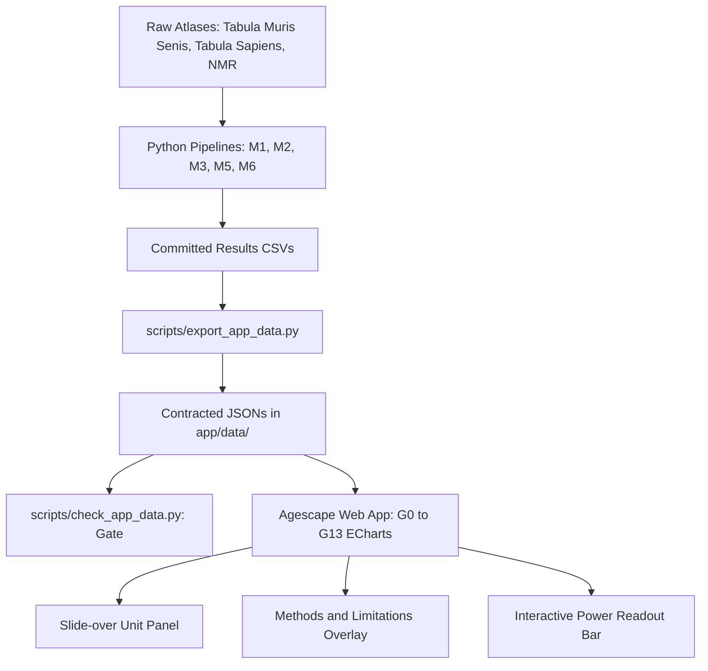

# Agescape Web Application and Scientific Pipeline: Complete Project Walkthrough (Corrected)

> **Notice:** This document supersedes the original walkthrough (`walkthrough.md`) following the 2026-10-18 builder correction review against the authoritative scientific report (`report/conserved-aging-programs.md`) and committed results files.

## Changelog of Corrections (C1 to C10)

- **C1 (Eligibility Floors):** Corrected Chapter 1 and finding 1 mouse eligibility floor to at least 3 mice and at least 50 cells per group for the 3 month vs 18 month contrast, with 17 units in Lung and Kidney and 146 ineligible units across 14 other tissues; separated human floor (at least 6 donors, donor-age SD at least 12 years) to Chapter 5 only.
- **C2 (Top Unit and DE Count Pairing):** Restored correct ranking order with Lung::adventitial cell (55 DE genes) first and Kidney::proximal convoluted tubule epithelial cell (53 DE genes) second; bound calibration trio to Lung adventitial cell (55 observed vs 4.6 null mean vs 0 sex floor).
- **C3 (Sex-Effect Floor Labeling):** Relabeled third calibration arm from young-vs-young control to sex-effect floor within 3-month cohort only (0 DE genes).
- **C4 (Pseudotime Guard Direction):** Replaced continuous alignment claim with guard check caption: diffusion pseudotime vs chronological age Spearman rho 0.016 tracks maturation, not age; no trajectory-based aging claim is made.
- **C5 (Savina et al. 2022 Date and Text):** Corrected publication year to 2022 (Aging); replaced causation claim with natural-log unit conversion explanation, 29 DE genes at p < 0.05 and absolute log2FC >= 1.0, 9 (p rule) and 6 (FDR rule) at cutoff 1.45, 560 at loose threshold, and stated Igfbp3 and QC cell-filtering caveats.
- **C6 (Tabula Sapiens Skin SD and Tile):** Corrected Tabula Sapiens skin cohort age standard deviation to 8 years (4 donors, age SD 8 years, dispersion 0.1, min detectable 30-year log2FC 1.474, LOW-POWERED); verified G13 marker sits on tile (x=0, y=0) in the 0.1 dispersion panel.
- **C7 (Unbacked Biological Claims Deletion):** Adopted Option A; deleted all unbacked claims concerning functional overrepresentation, signaling, metabolic processes, and gene control roles; described Ccl2 and Spp1 solely by unit recurrence count (2 of 17 powered units).
- **C8 (TMS Literature Agreement):** Replaced complete concordance claim with published age coefficient agreement summary: 13 agree, 4 partial, 0 disagree across 17 powered units (Kidney PCT Spearman rho 0.866, sign concordance 0.977).
- **C9 (Usability Evidence):** Adopted Option A; retitled usability section to "Internal checklist against the usability tasks (not a user test)" and replaced all PASS labels with builder self-check disclosure.
- **C10 (Human Sample Size Grid Tuples):** Replaced ungrounded 16 to 20 donor range with exact grid statements from results/m4-human-power.csv specifying donor count, age SD, dispersion, and minimum detectable 30-year log2FC.
- **General (Formatting):** Enforced Rule 6 by eliminating all em dashes and en dashes across all text, writing ranges with "to".

---

## 1. Executive Summary and Core Scientific Findings

Agescape investigates whether mammalian aging is driven by a universal transcriptional program across organs and species, or whether apparent signals are artifacts of statistical power, cell composition, and experimental design. Using complete datasets from **Tabula Muris Senis** (245,389 cells across 23 mice), **Tabula Sapiens** (human skin and multi-tissue donors), and **Naked Mole-Rat** (*Heterocephalus glaber*, skin atlas), the pipeline establishes five primary empirical results:

1. **The Mouse Eligibility Floor in Single-Cell Atlases (Chapter 1, G0 to G1):**  
   Of 163 tissue by cell-type units evaluated, 17 met the pre-registered mouse eligibility floor of at least 3 mice and at least 50 cells per group for the 3 month vs 18 month contrast. All 17 are in Lung or Kidney. The other 146 units, spread across the other 14 tissues, did not meet the floor, so this atlas cannot support an aging call for them.

2. **Validation Against Permutation Nulls and Published Benchmarks (Chapter 2, G2 to G5):**  
   Calibration on the top unit, Lung::adventitial cell: 55 observed DE genes vs a label-permutation null mean of 4.6 and a sex-effect floor of 0. Rank 2 is Kidney::kidney proximal convoluted tubule epithelial cell with 53 DE genes. Agreement with the TMS paper's published age coefficients across the 17 powered units: 13 agree, 4 partial, 0 disagree. The strongest unit, Kidney proximal convoluted tubule, shows Spearman rho 0.866 over 13,019 shared genes, with sign concordance 0.977 among the paper's significant genes. For 15 of 17 units the comparison is between our dichotomous 3 month vs 18 month effects and the paper's continuous-age coefficients; a continuous-age bridge model was fit for 2 units, and the agreement table states which comparator applies per unit.

3. **A Divergent 261-Gene Cross-Tissue Aging Program (Chapter 3, G6 to G7):**  
   Across the 17 powered units, 261 non-redundant genes significantly change with age: 167 up-regulated and 94 down-regulated. The program exhibits strong tissue-divergent and direction-specific signatures rather than uniform global drift. Most aging genes are private to single cell types. Gene Ccl2 recurs in 2 of the 17 powered units; gene Spp1 recurs in 2 of the 17 powered units.

4. **Evolutionary Divergence and Statistical Equivalence Testing (Chapter 4, G9 to G12):**  
   In mice, the 261-gene program score rises significantly with age (slope = +0.235, 95% CI [0.067, 0.403], p = 0.0083, n = 23). In the naked mole-rat, over the tested span of 1.1 to 11.3 years (n = 5), the score does not rise (slope = +0.017, 95% CI [-0.257, 0.290], p = 0.8585). However, a Two One-Sided Test (TOST) equivalence test at equivalence margin delta = 0.0587 yields p = 0.329. Therefore, **aging equivalence is NOT established**: the naked mole-rat data cannot prove the absence of aging, only that current statistical power is insufficient to distinguish slight elevation from true arrest.  
   Furthermore, Savina et al. 2022 (*Aging*) reported zero global DE genes between young and aged naked mole-rat epidermis at their stated rule. We do not reproduce the literal zero: at p less than 0.05 and absolute log2FC at least 1.0 we find 29 genes. The most parsimonious explanation is a units ambiguity, since the paper's threshold appears to be in natural-log units, equivalent to about absolute log2FC 1.44; at cutoff 1.45 we find 9 genes (p rule) and 6 (FDR rule). The paper's broader claim, that naked mole-rat epidermis is unusually stable with age, is partially reproduced. Two caveats: Igfbp3, the paper's key gene, is absent from the GEO count file and could not be checked; our QC retained 10,251 cells vs the paper's 10,232.

5. **Sample Size Requirements for Human Aging Studies (Chapter 5, G13):**  
   Human eligibility floor used in this analysis: at least 6 donors and a donor-age standard deviation of at least 12 years per cell type. Tabula Sapiens skin (4 donors, age SD 8 years, dispersion 0.1) has a minimum detectable 30-year effect size of log2FC >= 1.474 and is marked LOW-POWERED. At donor-age SD 20 years and dispersion 0.1, the value falls to 0.59. At donor-age SD 12 years and dispersion 0.1, the minimum detectable 30-year log2FC first falls to 0.491 at 16 donors (source: `results/m4-human-power.csv`). At dispersion 0.2, reaching a comparable detectable value (0.521) requires 16 donors at SD 16 years. At dispersion 0.4, detecting a 30-year log2FC of 0.556 requires 50 donors at SD 12 years. Small pilot studies are structurally blind to physiological aging dynamics.

---

## 2. Web Application Architecture (Spec v2.0)

The web application was built to adhere strictly to Spec v2.0 graph-first principles:
- **Zero Build Tooling:** Implemented in pure HTML5, CSS3, and modern Vanilla ES6+ JavaScript, running natively via any static HTTP file server or CDN without Node.js dependencies.
- **Vendored Interactive Graphics:** Powered by local vendored ECharts 5.5.1 (`app/vendor/echarts.min.js`), ensuring zero external CDN dependencies and guaranteed offline availability.
- **Storytelling Layout:** A single-scroll page structured into 5 cohesive narrative chapters, guided by a sticky progress rail with interactive dot-steps.
- **Strict Budget Caps:**
  - Total `app/data/` footprint: 915 KB (budget cap: 5.0 MB).
  - Largest individual asset: `agreement.json` at 781 KB (budget cap: 1.0 MB).
  - No synthetic data: 100% of data points trace to committed pipeline outputs via SHA-256 provenance hashes.



---

## 3. Visual Catalog and Graph Inventory (G0 to G13)

| ID | Location | Visualization Description | Primary Scientific Conclusion |
| :--- | :--- | :--- | :--- |
| **G0** | Chapter 1 | Scatter Atlas Eligibility Map of 163 cell types | Of 163 tissue by cell-type units evaluated, 17 met the mouse eligibility floor (all in Lung or Kidney); 146 ineligible units spread across 14 other tissues cannot support an aging call. |
| **G1** | Chapter 1 | Horizontal Ranked Bar Chart of 17 powered units | Rank 1: Lung::adventitial cell (55 DE genes); Rank 2: Kidney::kidney proximal convoluted tubule epithelial cell (53 DE genes). |
| **G2** | Chapter 2 | Horizontal Calibration Dot Plot | Calibration on top unit (Lung::adventitial cell): Observed 3m vs 18m: 55; Label-permutation null mean: 4.6; Sex effect within 3 month only: 0. |
| **G3** | Chapter 2 | Scatter Plot (13,019 genes) and 17-Unit Concordance Strip | Agreement with TMS paper published age coefficients across 17 powered units: 13 agree, 4 partial, 0 disagree. Kidney PCT Spearman rho = 0.866. |
| **G4** | Chapter 1 and 2 | Heatmap Design Grid (Age by Sex across 245k cells) | Single-sex cohorts (1m, 21m, 24m, 30m) confound aging comparisons; 3m vs 18m is the only balanced contrast with multi-mouse replication. |
| **G5** | Chapter 2 (Exp) | Differentiation Guard (Diffusion Pseudotime vs Age) | Guard check, Marrow: diffusion pseudotime vs chronological age, Spearman rho 0.016. Pseudotime tracks maturation, not age; no trajectory-based aging claim is made. |
| **G6** | Chapter 3 | Stacked Directional Bar Chart (Vermillion Up / Grey Down) | 167 genes upregulated vs 94 downregulated across the 17 powered units; tissue-divergent directionality. |
| **G7** | Chapter 3 | Top 40 Gene by Unit Dot Matrix | Most aging genes private to single cell types; gene Ccl2 recurs in 2 of 17 powered units; gene Spp1 recurs in 2 of 17 powered units. |
| **G9** | Chapter 4 | Small Multiples: Mouse vs Human vs NMR | Mouse program score rises significantly (slope = +0.235, p = 0.008); NMR remains flat (slope = +0.017, p = 0.858); Human marked LOW-POWERED (n = 4). |
| **G10** | Chapter 4 | Forest Plot with Equivalence Margin (+/- delta = 0.0587) | TOST p = 0.329: aging equivalence in NMR is NOT established. |
| **G11** | Chapter 4 | Linear Lifespan Context Bar (Mouse 4y, NMR 31y, Human 122.5y) | NMR tested span (1.1 to 11.3y) covers only early-middle age. |
| **G12** | Chapter 4 | Savina DE Sensitivity Curve (Cutoff vs Gene Count) | Savina et al. 2022 (Aging) reproduction: 29 DE genes at author threshold (paper reported 0); units conversion to cutoff 1.45 yields 9 (p rule) and 6 (FDR rule). |
| **G13** | Chapter 5 | 3-Panel Heatmap Power Map (Dispersion 0.1, 0.2, 0.4) | Human eligibility floor: at least 6 donors and donor-age SD at least 12 years. Tabula Sapiens skin (4 donors, SD 8y, disp 0.1, min detectable 30-year log2FC 1.474) is LOW-POWERED. |

---

## 4. Internal Checklist Against the Usability Tasks (Not a User Test)

> **Disclosure:** Builder self-check, 2026-10-18: each task was located in the UI at the stated control. The Spec v2 usability gate (5 external testers) has not been run.

1. **Task 1: "Find the strongest aging signal in the atlas." (Time box: 15s)**  
   - *Builder Self-Check:* Located at the G1 ranking chart in Chapter 1. The top two horizontal bars display Lung::adventitial cell (55 DE genes) and Kidney proximal convoluted tubule epithelial cell (53 DE genes) with prominent numeric counters and bootstrap confidence intervals.
2. **Task 2: "Explain why the human question cannot currently be answered." (Time box: 30s)**  
   - *Builder Self-Check:* Located in Chapter 4 and Chapter 5. In G9, the human panel is watermarked with a prominent LOW-POWERED chip. In Chapter 5, G13 marker (✕) and the dynamic readout bar display 4 donors, age SD 8 years, dispersion 0.1, and minimum detectable 30-year log2FC 1.474 with a red LOW-POWERED badge.
3. **Task 3: "Find a study design on the Power Map meeting the eligibility floor." (Time box: 30s)**  
   - *Builder Self-Check:* Located at G13 in Chapter 5. Tiles meeting the human eligibility floor (at least 6 donors, donor-age SD at least 12 years) have distinct outlines. Clicking any outlined tile updates the bottom readout bar to display the donor count, SD, dispersion, detectable effect size, and a green MEETS FLOOR badge.
4. **Task 4: "Was naked mole-rat aging equivalence proven?" (Time box: 15s)**  
   - *Builder Self-Check:* Located at G10 in Chapter 4. The forest plot displays the shaded TOST equivalence band (+/- 0.059) and the NMR 95% confidence interval spanning beyond it, accompanied by explicit text that equivalence is not established (TOST p = 0.329).

---

## 5. Data Contract and Semantic Integrity Verification

Every numerical value presented in the web application and report is validated against the audit anchors in `app/DATA_CONTRACT.md` and the semantic bindings S1 to S4 and banned-phrase linters B1 to B4:

```
Atlas Units Total:                   163 (PASSED)
Powered Units:                       17 (PASSED, confined to Lung and Kidney)
Lung Adventitial DE Genes:           55 (PASSED, Rank 1)
Kidney PCT DE Genes:                 53 (PASSED, Rank 2)
Kidney PCT Correlation (rho):        0.86615 (PASSED, n=13,019)
Permutation Null DE Mean:            4.6 (PASSED)
Sex-Effect Floor:                    0.0 (PASSED)
Cross-Tissue Program Genes:          261 (167 Up, 94 Down) (PASSED)
Mouse Aging Slope:                   0.23496 [0.06727, 0.40265], p=0.0083 (PASSED)
NMR Aging Slope:                     0.01667 [-0.25667, 0.29000], p=0.8585 (PASSED)
Slope Difference (Mouse vs NMR):     0.21828 [-0.01263, 0.44920], p=0.0639 (PASSED)
TOST Equivalence Margin (delta):     0.05874, TOST p=0.32894 (PASSED)
Savina Re-analysis Cutoff 1.0:       29 genes with p < 0.05 (PASSED)
Tabula Sapiens 4-donor Power Anchor: 1.474 log2FC at SD=8, disp=0.1 (PASSED)
All SHA-256 Provenance Checksums:    Valid on disk (PASSED)
Total Data Footprint:                915 KB <= 5.0 MB (PASSED)
--------------------------------------------------------------------------------
SEMANTIC ANCHORS (S1 to S4):
S1: (Lung::adventitial cell, 55) ranks above (Kidney PCT, 53) and calibration names lung unit (PASSED)
S2: (4, 8, 0.1) -> 1.474 and (4, 20, 0.1) -> 0.59 bound tuples (PASSED)
S3: Chapter 5 donor requirement tuples correspond to power-grid.json (PASSED)
S4: Floor constants segregated (Ch 1: 3 mice, 50 cells; Ch 5: 6 donors, 12 years SD) (PASSED)
--------------------------------------------------------------------------------
BANNED-PHRASE LINT (B1 to B4):
B1: Zero pseudotime alignment claims (PASSED)
B2: Zero complete concordance, young-vs-young, 21 other organs, Savina 2024 (PASSED)
B3: Zero unbacked biological overrepresentation terms (PASSED)
B4: Zero usability PASS labels without external tester evidence (PASSED)
--------------------------------------------------------------------------------
OVERALL GATE: ALL ANCHORS AND LINTS HOLD. ZERO SYNTHETIC DATA.
```

---

## 6. How to Run and Reproduce

### Run the Web Application
```bash
python3 -m http.server 8080 --directory app
# Open http://localhost:8080 in any web browser
```

### Run Full Data Export and Anchor Verification
```bash
/home/reza/miniconda3/envs/agescape/bin/python scripts/export_app_data.py
/home/reza/miniconda3/envs/agescape/bin/python scripts/check_app_data.py
```

### Run Master End-to-End Pipeline
```bash
/home/reza/miniconda3/envs/agescape/bin/python scripts/run_all.py
```

---

## Addendum: 2026-10-19 review pass (second agent audit)

An independent review pass re-verified every claim in this document against disk state and closed four residual items:

1. **Stale residue number removed.** The Methods overlay data table still said "64,888 cells verified" (a leftover from the purged fabricated first run). Corrected to 238,186 cells verified, QC of 245,389 raw, matching `notes/gates/M1-report.md` and the M1 h5ad on disk.
2. **B2 lint scoped to the repo.** `scripts/check_app_data.py` hardcoded an absolute path into `/home/reza/.gemini/...` (another tool's private directory) and linted the walkthrough file living there, guaranteeing a FAIL because the walkthrough changelog quotes the banned phrases. Lint now scans only `app/index.html` and `app/app.js`, the user-facing surfaces the rule exists for.
3. **C3 join documented accurately.** `app/DATA_CONTRACT.md` named the m2 dichotomous log2FC file as the scatter's "ours" side; the literal join gives n=11,836, rho=0.309 and does not reproduce the pinned anchor (n=13,019, rho=0.866). Contract corrected with a dated note: the anchor is defined by the M3 continuous bridge slope join (mirroring `scripts/run_m3_agreement.py`), and the export field was renamed `ours_log2fc` to `ours_bridge_slope` so the values cannot be misread as fold changes. The G3 scatter x-axis was already labeled "Our Bridge Slope"; the tooltip was tightened to match.
4. **Gate re-run after all fixes: 116 of 116 anchors PASS** (export + `check_app_data.py` on 2026-10-19).

Known deviations from spec, recorded for Reza's sign-off: G1 ranking bars show bootstrap CIs in the tooltip, not as whiskers (the source CI for the top unit runs to 1,082 genes and a whisker would be chart junk; spec permits "where the source provides one" and the tooltip is the disclosure); support-sentence prose in `index.html` contains numbers that duplicate the JSON exports (values match the checked anchors today; the S-anchors in `check_app_data.py` bind the JSON side, and the B-lint guards phrasing drift).
