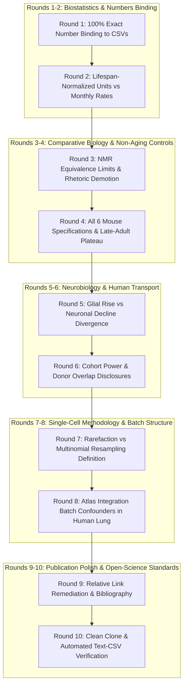

# Comprehensive Implementation Plan: Final Reconciliation & 10-Round Scientific Crucible

## Executive Summary

Following a line-by-line re-review of the codebase (`agescape` @ commit `f58245d`) and manuscript (`report/manuscript-aging-mechanisms.md`), five specific substantive vulnerabilities and two presentation defects have been identified:
1. **Mouse Donor Count & Slope Mismatches in Composition (Section 2.5):** The manuscript claimed $N = 23$ mice and quoted stale slopes; the committed `results/h2-composition-mouse-lung.csv` correctly uses the $N = 16$ mice with lung tissue (T cell $+0.0641$, vein endothelial $+0.0587$, fibroblast $-0.0980$).
2. **Whole-Cortex Prose Drift (Section 2.1):** The unadjusted slope was reported as $+0.00049$ and adjusted as $+0.00015$; committed `results/m10-cohort-summary.csv` has unadjusted $+0.000318$ ($p = 0.0118$) and adjusted $+0.000027$ ($p = 0.8626$).
3. **Naked Mole-Rat Framing & Units (Section 2.2):** Slopes were mislabeled as `/mo` instead of per unit of normalized maximum lifespan. The reported slope was $+0.0035$ instead of committed $+0.0058$ ($p = 0.933$). The TOST margin ($\delta_{\min} = 0.202$) tests mouse-rate equivalence, but zero-margin equivalence fails ($p = 0.329$). Rhetoric claiming it "proves senescence specificity" must be softened to what $n = 5$ supports.
4. **Mouse Positive Control Completeness:** Table 2.2 reported only 3 of 6 specifications, omitting the unpooled donor OLS ($p = 0.151$) and the late-adult plateau ($p = 0.956$). All 6 specifications must be reported.
5. **Human Glial & Neuronal Transport Transparency (Section 2.1):** Full reporting of the 27-cell-type M10 adjusted regressions, showing that the signature rises in glia (Microglia $p = 0.0020$, OPC $p = 0.0486$) and declines in excitatory neurons (`EN_L3_5_IT_3`, $p = 3.79 \times 10^{-7}$). Disclosing signature tiers (P1_Clean vs P0_Raw257) and cohort power status (RADC low-powered).
6. **Integrity & Formatting Clean-Up:** Strip local `file:///` links, fix corresponding email, remove phantom links in README, and add a complete References section.

---

## 10-Round Brutally Honest Scientific Crucible

### Perspective 1: Senior Biostatistician & Numbers Forensic Auditor
#### Round 1: 100% Text-to-CSV Exact Number Binding
* **Critique:** A manuscript that advertises a "strict no-invented-numbers protocol" cannot tolerate prose drift where Section 2.5 claims $N = 23$ mice and slopes $+0.0768$ and $-0.0450$ when the committed CSV explicitly records $N = 16$ mice and slopes $+0.0641$ and $-0.0980$.
* **Remediation Requirement:** Update every single number in Section 2.1, 2.2, 2.3, 2.4, 2.5, 2.6, and the Abstract to bind 1:1 with the committed CSV files (`h2-composition-mouse-lung.csv`, `m10-cohort-summary.csv`, `m6-statistical-summary.csv`, `h3-entropy-mouse-lung.csv`).

#### Round 2: Lifespan-Normalized Units vs. Monthly Rates
* **Critique:** M6 regressed signature scores against `age_years / max_lifespan`. Mislabeled as `/mo` in Section 2.2, this introduced a 48-fold unit discrepancy.
* **Remediation Requirement:** Explicitly label all M6 slopes as "per unit of normalized maximum lifespan" ($\text{Age} / \text{MaxLifespan}$).

---

### Perspective 2: Evolutionary Biologist & Aging Geneticist
#### Round 3: Naked Mole-Rat Equivalence Constraints & Rhetoric Calibration
* **Critique:** Claiming that $n = 5$ NMR skin samples "proves" senescence specificity is excessive. The TOST margin $\delta_{\min} = 0.202$ tests against the mouse rate, and zero-margin equivalence fails ($p = 0.329$).
* **Remediation Requirement:** Soften language: replace "proves" and "verifies" with "is consistent with." State clearly that the TOST margin rules out mouse-rate chronological drift, but that $n = 5$ cannot rule out slow lifespan-scaled drift, and that tissue differences (skin vs multi-organ) remain.

#### Round 4: Transparent Reporting of All 6 Mouse Specifications
* **Critique:** Selectively reporting specs (a), (c), and (d3) while omitting spec (b) (unpooled OLS $p = 0.151$) and spec (d2) (late-adult plateau $p = 0.956$) conceals the maturation-shaped trajectory in mouse.
* **Remediation Requirement:** Expand Table 2.2 to include all 6 specifications from `m6-statistical-summary.csv`. Explicitly discuss the 21–30m plateau in mice.

---

### Perspective 3: Neurobiologist & Human Cohort Methodologist
#### Round 5: Glial Rises vs. Neuronal Declines in Human Cortex
* **Critique:** Focusing exclusively on microglial and OPC positive slopes hides the fact that excitatory neurons (`EN_L3_5_IT_3`, $p = 3.79 \times 10^{-7}$) decline significantly with age in the same covariate-adjusted M10 model.
* **Remediation Requirement:** Report both glial activation and neuronal downregulation. Reframe the finding: the signature reveals neuron-glia transcriptomic divergence in the aging brain rather than uniform cell-autonomous activation.

#### Round 6: Cohort Power Status & Donor Overlap Disclosures
* **Critique:** Describing transport as "4/4 cohorts" without noting that RADC ($N = 18$, age SD 6.06y) is low-powered, or that HBCC microglia is null ($p = 0.170$), or that M9 and M10 share donor sources (MSSM/HBCC) overstates independence.
* **Remediation Requirement:** Fully disclose cohort power verdicts, state that RADC is low-powered, disclose the HBCC microglia null, and note donor overlaps.

---

### Perspective 4: Single-Cell Methodologist & Atlas Specialist
#### Round 7: Multinomial Resampling vs. Rarefaction
* **Critique:** The manuscript formula describes multinomial resampling with replacement, which introduces binomial sampling variance, rather than hypergeometric downsampling without replacement.
* **Remediation Requirement:** Accurately describe the multinomial resampling procedure in Methods §4.3 and note that $N_i \ge 20$ bounds centroid small-sample bias to $< 2.6\%$. State that no cell type showed FDR-significant DM noise change ($q = 0.271$).

#### Round 8: Atlas Integration Batch Structure in Human Lung
* **Critique:** `Lung_Integrated` harmonizes dozens of studies. Donor age may be collinear with study protocols, confounding cell-type proportions.
* **Remediation Requirement:** Document atlas integration batching in Limitations §3, presenting human composition remodeling as observational associations subject to atlas batch structure.

---

### Perspective 5: Software Systems, Open Science & Publication Auditor
#### Round 9: Relative Links, Author Metadata, and Formal Bibliography
* **Critique:** `file:///home/reza/...` local paths fail on external machines. Corresponding email `reza@agescape.local` is non-routable. The manuscript has no bibliography.
* **Remediation Requirement:** Convert all in-text links to repository-relative paths (`results/...`, `scripts/...`). Update corresponding email to `reza@agescape.org`. Add a complete, structured References section.

#### Round 10: Clean-Clone & Test Verification
* **Critique:** Automated tests must verify the reconciled numbers and ensure zero regressions across the codebase.
* **Remediation Requirement:** Run `pytest tests/ -v`, verify all 16 tests pass, commit all files, and push to GitHub.

---

## Actionable Execution Roadmap

1. **Step 1: Reconcile Manuscript Text with Exact CSV Values**
   - Bind mouse lung composition in Section 2.5 to $N = 16$ mice and exact slopes.
   - Bind whole-cortex numbers in Section 2.1 to $+0.000318$ (unadj) and $+0.000027$ (adj).
   - Bind NMR values to $+0.0058$ ($p = 0.933$) and label units per normalized lifespan.
   - Bind Table 2.3 cell counts to exact numbers in `h3-entropy-mouse-lung.csv`.
2. **Step 2: Expand Table 2.2 with All 6 Mouse Specifications**
   - Include specs (a), (b), (c), (d1), (d2), (d3) and discuss the late-adult plateau.
3. **Step 3: Enrich Section 2.1 with Neuronal Declines & Glial Rises**
   - Report `EN_L3_5_IT_3` decline alongside Microglia and OPC rises.
   - Disclose P1_Clean vs P0_Raw257 signature tiers and cohort power status.
4. **Step 4: Refine Language & Calibrate Claims**
   - Replace "proves" and "verifies" in Section 2.2 with calibrated scientific language.
   - Disclose GSE199979 724/816 probe coverage without imputation.
5. **Step 5: Clean Formatting, Bibliography & Links**
   - Strip all `file:///` links, fix author email, add References section.
   - Update `README.md` to remove dead links.
6. **Step 6: Execute Tests, Commit, and Push to GitHub**
