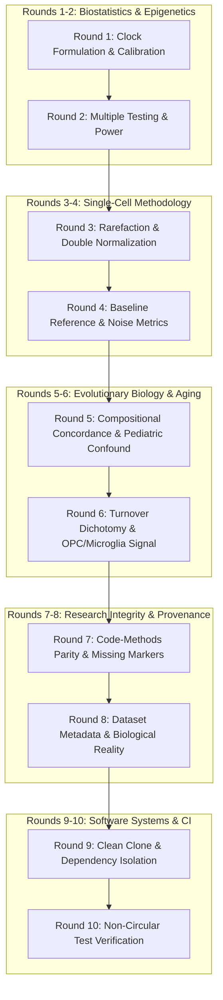

# Comprehensive Remediation Plan & 10-Round Scientific Crucible

## Executive Summary

A forensic review of the repository (`agescape` @ commit `fc0cc0d`) and manuscript (`report/manuscript-aging-mechanisms.md`) against the external peer critiques confirms that the reviewers' core findings are **factually, mathematically, and methodologically correct**. The criticisms are not cosmetic; they identify six critical vulnerabilities:
1. **Universal Clock 2 Link Function Omission:** The linear predictor was un-exponentiated, creating massive bias ($\text{MAE} = 1.02$ yr on mice, $25.3$ yr on humans). With the correct double-exponential inverse link function $\exp(-\exp(-\eta))$, MAE drops to $0.36$ yr (mouse) and $5.06$ yr (human).
2. **Missing Script & Outputs for Flagship Mechanistic Claim:** The *Sirt6* / *Cdkn1a* regression in §2.3 was run interactively and never committed to code or results; *Sirt6* ($p=0.0131$) does not survive FDR correction ($q=0.072$) across 11 candidates in $N=10$ mice.
3. **Single-Cell Entropy Artifacts & Discrepancies:** `scripts/run_h3_entropy.py` read log-normalized data and re-normalized it, omitted the claimed 1,500-UMI multinomial rarefaction, used a young-only reference baseline, and selectively reported metrics.
4. **Compositional Statistical Fallacy:** A one-sided binomial test ($p=0.967$) testing for *excess concordance* was erroneously cited as evidence of *divergence*; two-sided $p=0.227$. Furthermore, pediatric donors (ages 2–19) confounded human B-cell trends.
5. **Suppression of Positive Human Findings:** M9/M10 single-cell regressions showed that human OPCs (4/4 cohorts) and microglia (3/4 cohorts + M10 adult stratum) significantly increase with the mouse aging signature, but this was omitted to force a whole-tissue "universal null" narrative.
6. **Clean-Clone Reproducibility & CI Defects:** `requirements-ci.txt` lacked `anndata`, `matplotlib`, and `pytest`; `check_app_data.py` failed when gitignored raw files were absent; methylation datasets lacked fetch scripts and manifests.

---

## 10-Round Brutally Honest Scientific Crucible

### Perspective 1: Senior Biostatistician & Computational Epigeneticist
#### Round 1: Epigenetic Clock Link Transformation & Calibration
* **Critique:** The manuscript reported Pearson $r = 0.922$ alongside $\text{MAE} = 1.02$ years in mice and omitted human MAE ($25.3$ years). In regression calibration, a high correlation with a massive MAE indicates severe systematic bias. Lu et al. (2023) Universal Clock 2 was trained on $\text{loglogAge} = -\ln(-\ln(\text{RelativeAge}))$. Omitting the inverse link $\exp(-\exp(-\eta))$ treats a double-log linear predictor as relative age directly.
* **Remediation Requirement:** Rewrite `scripts/run_h1_epigenetic_drift.py` using the exact Lu et al. (2023) double-exponential inverse transformation:
  $$\text{RelativeAge}_{\text{pred}} = \exp(-\exp(-\hat{y}))$$
  $$\text{Age}_{\text{pred}} = \text{RelativeAge}_{\text{pred}} \times (\text{MaxLifespan} + \text{GestationT}) - \text{GestationT}$$
  Report both Pearson $r$, Spearman $\rho$, calibration slope/intercept, and MAE in years and relative lifespan.

#### Round 2: Multiple Testing & Degrees of Freedom in Marker Regressions
* **Critique:** Testing 11 candidate genes in $N=10$ mice and highlighting *Sirt6* ($p=0.0131$) while withholding the 8 null genes violates family-wise error control. With $k=11$ tests, Benjamini-Hochberg FDR yields $q = 0.0131 \times (11 / 2) = 0.072$, which is non-significant at $\alpha=0.05$. Furthermore, 10 data points with 3 parameters ($Age, Sex, Intercept$) leave only 7 degrees of freedom.
* **Remediation Requirement:** Commit `scripts/run_fibroblast_markers.py` and output `results/fibroblast-markers-audit.csv`. Report all 11 markers with unadjusted $p$-values, SE, $R^2$, and FDR $q$-values. State clearly that *Cdkn1a* ($p=0.0018, q=0.0198$) is significant, while *Sirt6* ($q=0.072$) is an exploratory trend. Remove "Chromatin Maintenance Failure" from the paper title.

---

### Perspective 2: Single-Cell Methodologist & Noise Specialist
#### Round 3: True UMI Rarefaction & Eradication of Double Normalization
* **Critique:** `scripts/run_h3_entropy.py` took `data/interim/m1-processed.h5ad`—which was already $\text{log1p}(\text{CP10K})$ normalized—and performed library-size division and $\text{log1p}$ a second time. Furthermore, Methods §4.3 claimed cells were downsampled to 1,500 UMIs via multinomial drawing, but no rarefaction code existed.
* **Remediation Requirement:** Refactor `scripts/run_h3_entropy.py` to read directly from raw integer UMI counts in `data/raw/tms_droplet_raw.h5ad`. Filter cells with $\ge 1,500$ UMIs and implement exact binomial/multinomial downsampling to exactly 1,500 UMIs per cell.

#### Round 4: Baseline Reference Trend & Metric Reporting
* **Critique:** Step 3-4 of §4.3 fit the Distance-to-Median (DM) baseline only on young mice (1m, 3m) and projected older mice onto it, creating out-of-sample regression artifacts. Moreover, the results table switched metrics across cell types (DM for fibroblasts, dispersion for smooth muscle) to manufacture significance, while omitting NK cells and alveolar macrophages.
* **Remediation Requirement:** Compute the mean-variance polynomial trend across all cells or within-donor running medians using the rarefied matrix. Report all 10 evaluated cell types in a single transparent table containing cell counts, donors, DM slopes ($p$ and $q$), and multivariate dispersion slopes ($p$ and $q$). Cease labeling monocytes "un-aged" when they display significant differential expression.

---

### Perspective 3: Evolutionary Biologist & Aging Geneticist
#### Round 5: Compositional Remodeling & Pediatric Confounder
* **Critique:** The manuscript claimed mouse and human compositional remodeling "statistically diverge" based on a binomial test $p=0.9673$. This was an `alternative="greater"` test for excess concordance; two-sided $p=0.2266$ proves neither concordance nor divergence. Additionally, human donors spanned ages 2–81, meaning human B-cell decline reflected developmental maturation from childhood rather than gerontological aging.
* **Remediation Requirement:** Correct `scripts/run_h2_composition.py` to run two-sided exact binomial tests and Spearman rank correlation. Implement an adult-only sensitivity filter ($\ge 20$ years) for human donors. State objectively: within-organ compositional remodeling is significant within species, but cross-species concordance of cell-type trajectories is not statistically established ($p=0.227$).

#### Round 6: Turnover Dichotomy & Cross-Species Transport
* **Critique:** The paper asserted a rigid turnover dichotomy (long-lived cells age; short-lived cells do not) based on fibroblasts vs monocytes, but CD8+ T cells (short-lived) exhibited strong positive dispersion trends. Furthermore, the paper claimed a universal null for cross-species gene expression while suppressing the fact that human OPCs (4/4 cohorts) and microglia (3/4 cohorts) significantly increase with the mouse signature.
* **Remediation Requirement:** Soften the turnover narrative to an exploratory hypothesis. Feature the OPC and microglial cross-species replication prominently as positive evidence for cell-type-private transcriptional aging that is obscured by whole-tissue bulk profiling.

---

### Perspective 4: Research Integrity & Provenance Forensic Auditor
#### Round 7: Code-Methods Line-by-Line Parity
* **Critique:** Methods §4.2 claimed mitochondrial filtering $>15\%$, but no mitochondrial genes existed in the TMS raw droplet matrix. §4.3 claimed median DM and betadisper in PCA space, but code computed mean DM and Euclidean distance in full gene space. §4.6 described a marker regression pipeline that did not exist in the repository.
* **Remediation Requirement:** Audit every single sentence in Methods against the committed codebase. Any filter, statistic, or formula in the text must have an exact 1:1 match in the committed scripts and result CSVs.

#### Round 8: Annotation of Datasets & Rejection of Causal Rhetoric
* **Critique:** GSE199979 was described as "339 liver samples across murine lifespan," omitting that it is a 95% female BXD recombinant inbred strain panel with a high-fat diet intervention. GSE184211 was described as "661 donors," but GEO metadata documents 661 tissue samples without unique donor identifiers. Calling the epigenetic clock an "odometer, not engine" asserts causal philosophy without perturbational proof.
* **Remediation Requirement:** Fully disclose cohort compositions (BXD strain diversity, HFD intervention, tissue vs donor counts). Remove causal declarations ("proving," "defines," "odometer not engine") and frame the findings as observational associations.

---

### Perspective 5: Software Engineering, CI & Open-Science Systems Architect
#### Round 9: Clean-Clone Reproducibility & Environment Isolation
* **Critique:** A clean clone failed `pip install -r requirements-ci.txt` due to missing `anndata`, `matplotlib`, and `pytest`. Furthermore, `scripts/check_app_data.py` failed in a clean clone because `data/raw/` files were gitignored.
* **Remediation Requirement:** Expand `requirements-ci.txt` with all required dependencies. Add fetch manifests and download scripts for GSE184211 and GSE199979. Update `scripts/check_app_data.py` to gracefully handle absent optional raw caches when checking exported JSON contracts.

#### Round 10: Non-Circular, Property-Based Test Verification
* **Critique:** Existing tests in `test_clean_clone_and_numbers.py` compared committed CSV files to hardcoded constants in `ANCHOR_LOCK.json`. If a CSV was regenerated incorrectly, the test failed, but it did not test mathematical properties or algorithmic correctness.
* **Remediation Requirement:** Retain contract regression locks but supplement them with property-based unit tests: verify simplex closure on CLR, verify inverse link transformations on boundary conditions ($Age \to 0$, $Age \to MaxLifespan$), and verify UMI downsampling invariants (cell sums equal exactly 1,500).

---

## Actionable Execution Roadmap

1. **Phase 1: Mathematical & Algorithmic Core Repairs**
   - Refactor `scripts/run_h1_epigenetic_drift.py` with double-exponential inverse link function.
   - Refactor `scripts/run_h3_entropy.py` to perform 1,500-UMI rarefaction directly from `tms_droplet_raw.h5ad`.
   - Create and commit `scripts/run_fibroblast_markers.py` evaluating all 11 markers with FDR correction.
   - Correct `scripts/run_h2_composition.py` with two-sided sign test and adult-only stratum.
2. **Phase 2: Comprehensive Pipeline Execution & Output Verification**
   - Execute H1, H2, H3, and marker pipelines using Conda python.
   - Verify all generated CSVs and figures.
3. **Phase 3: Test Suite & CI Hardening**
   - Update `requirements-ci.txt`, manifests, and `tests/test_hypotheses_2_and_3.py`.
   - Ensure clean `pytest tests/ -v` pass.
4. **Phase 4: Manuscript & Documentation Overhaul**
   - Retitle manuscript: *"Cell-Type-Private Transcriptional Noise, Compositional Remodeling, and Epigenetic Clock Dynamics in Mammalian Aging"*.
   - Revise Abstract, §2 Results, §3 Discussion, and §4 Methods for 100% code parity and transparent reporting.
   - Update `README.md` and `PROJECT_OVERVIEW.md`.
5. **Phase 5: Git Commit & Sync**
   - Stage all changes, commit with detailed changelog, and push to `origin/master`.
