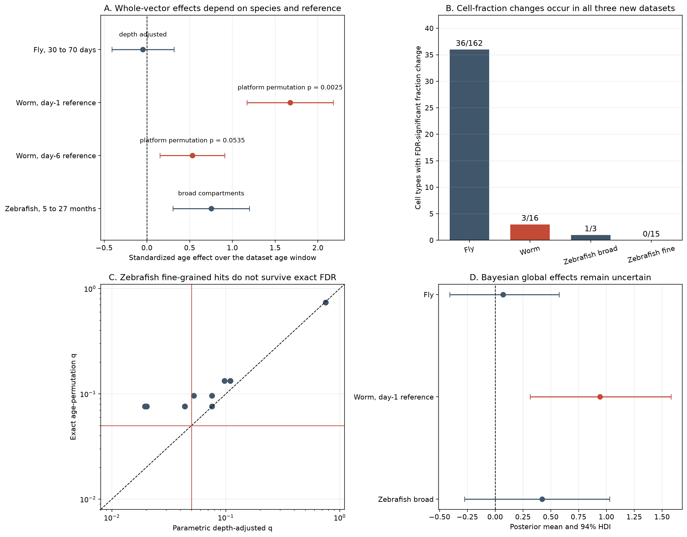

# Cell composition and expression-vector displacement across six species

## Bottom line

Aging changes the cellular composition of tissues in several species, and it changes gene expression in specific cell types. These results do not support a universal increase in whole-transcriptome displacement with age.

The new datasets strengthen three conclusions:

1. **Cell-type fractions can change substantially.** Fly, worm, and zebrafish all show age-associated fraction changes. This does not demonstrate fibrosis or organ destruction.
2. **Expression changes are cell-type specific, not one directional program.** Fly has many significant cell types in both directions and a null average. Zebrafish has stronger evidence for immune-fraction change than for cell-intrinsic expression displacement. Worm has a strong positive result with a day-1 reference, but the effect becomes smaller and less secure with a more balanced day-6 reference.
3. **The young reference and technical design matter.** Sequencing platform, UMI depth, germ-cell-stage composition, reproductive status, and the choice of reference age can change the estimated effect. A single large effect from one reference is not a species-wide aging law.

The earlier mouse, human, and naked mole-rat results remain consistent with this interpretation. Mouse shows a positive overall vector association. Human shows no overall association after technical scrutiny, although interneuron transcriptional aging replicates. Five naked mole-rat animals cannot establish stability or a between-species difference.

## Summary across species

| Species and dataset | Cell-fraction result | Expression-vector result |
|---|---|---|
| Mouse, Tabula Muris Senis | At least one FDR-significant fraction change in 8 of 13 adequately covered organs | Overall +0.1028 SD per 10% of maximum lifespan, p = 0.00000398; positive after depth adjustment |
| Human, public cohorts | At least one FDR-significant change in 3 of 11 cohort datasets | Overall +0.0365 SD, p = 0.2218; six unadjusted cell-type hits disappear after depth adjustment |
| Naked mole-rat skin | Inconclusive with five animals | Negative point estimate, exact p = 0.2; stability not established |
| Fruit fly, AFCA | 36 of 162 tested cell types pass FDR | 38 cell types pass depth-adjusted FDR in both directions; global effect -0.0467 SD, p = 0.7958 |
| C. elegans, Gao atlas | ARSC and spermatheca pass FDR after platform adjustment | Strong with day-1 reference; smaller and reference-sensitive with day-6 reference |
| Zebrafish testis | Immune fraction increases and remains significant after spermatogenesis adjustment | Broad effects do not survive exact permutation, Bayesian uncertainty, and phenotype adjustment |

## 1. Fruit fly: composition changes without a universal vector direction

### Design

The [Aging Fly Cell Atlas, GSE218661](https://www.ncbi.nlm.nih.gov/geo/query/acc.cgi?acc=GSE218661) provides annotated head and body nuclei. The primary analysis uses 36 pools measured at 30, 50, and 70 days in both organs. Thirty days is the young-adult reference. Five-day cells come from a different atlas and are excluded from the primary test because age and study batch are inseparable.

### Cell fractions

Thirty-six of 162 tested cell types show an age-associated fraction change at FDR 0.05: 17 of 72 in body and 19 of 90 in head. All 36 retain the same direction when analysis is restricted to samples containing the cell type. Thirty remain FDR-significant in that observed-record analysis, and 31 remain significant after adjusting for total recovered nuclei.

Examples include decreased adult fat body in body, increased head epithelial cells, increased skeletal muscle of head, and decreased photoreceptor R7. These are relative abundances among recovered annotated nuclei. They are not absolute counts of cells gained or lost in the whole organ.

### Expression vectors

Thirty-eight cell types pass depth-adjusted FDR: 13 in body and 25 in head. Effects occur in both directions. Indirect flight muscle and adult peripheral nervous system move away from the 30-day reference, while skeletal muscle of head and adult brain perineurial glia move closer to it. Movement toward the reference is not evidence of rejuvenation; it means the mean profile becomes more similar to the reference distribution.

The global depth-adjusted effect is -0.0467 SD over 40 days, with 95% CI -0.4102 to +0.3168 and p = 0.7958. Bayesian global means range from +0.0372 to +0.0837 across prior strengths, with every 94% HDI crossing zero. The average is therefore null, despite real cell-type-specific changes.

## 2. C. elegans: a strong signal whose size depends on the reference

### Design and composition

The [Gao atlas, GSE229022](https://www.ncbi.nlm.nih.gov/geo/query/acc.cgi?acc=GSE229022) contributes 12 wild-type OP50 pools at days 1, 6, 12, and 14. Each pool is one inferential unit. Germline and embryonic cells are analyzed separately in a somatic sensitivity analysis.

After sequencing-platform adjustment, ARSC increases by +0.2257 CLR units per day and spermatheca changes by -0.1255 CLR units per day. Both pass FDR in the whole-animal and somatic-only analyses. Germline also passes FDR in the whole-animal platform-adjusted model at -0.0700 CLR units per day, q = 0.0335. Neuron and muscle fractions do not pass FDR.

### Expression vectors with a day-1 reference

With day 1 as the young reference, the platform-adjusted global effect is +1.6755 SD over 14 days, p = 0.0000443. Platform-stratified donor-label permutation gives p = 0.0025. The somatic-only effect is +1.6666 SD, with permutation p = 0.0015. Eleven of 12 tested cell groups pass platform-adjusted parametric FDR, and nine retain permutation q below 0.05.

The independent [Roux atlas, GSE208154](https://www.sciencedirect.com/science/article/pii/S2211124723009130) supports the direction descriptively: 32 of 33 tested cell groups have positive depth-adjusted slopes, with median slope +0.0074 Hellinger units per day. GEO labels its libraries as technical replicates, so this is directional replication, not an independent biological-replicate p-value.

### What changes with a day-6 reference

Day 6 includes both sequencing platforms and therefore provides a less confounded reference. With that reference, no individual cell group survives platform-adjusted FDR. The all-cell global effect falls to +0.5319 SD. Its parametric p is 0.0189 and its platform-stratified permutation p is 0.0535. The somatic-only global effect is +0.4061 SD, with parametric p = 0.1517 and permutation p = 0.1834.

Bayesian analysis of the day-1 analysis gives a positive direction but a prior-sensitive magnitude. With prior SD 0.25, the depth- and platform-adjusted posterior mean is +0.3355 and the 94% HDI crosses zero. With prior SD 0.5, the mean is +0.9430 with a positive HDI. This is evidence of an age association, not a stable estimate of one universal effect size.

## 3. Zebrafish testis: immune-fraction change is the strongest result

### Design

The [zebrafish testis atlas, GSE275361](https://pmc.ncbi.nlm.nih.gov/articles/PMC11607696/) contains ten individual males at 5, 12, 20, 22, and 27 months. Technical channels are aggregated by fish. The all-age analysis compares germ-cell, immune, and blood-plus-other-somatic compartments. Fine germ-cell-stage labels are comparable only in the six fish aged 5 to 22 months.

### Cell fractions

The immune fraction increases by +0.0926 CLR units per month, q = 0.0203. It remains positive after total-cell adjustment, +0.1039, q = 0.000516, and after adjustment for incomplete spermatogenesis, +0.0532, q = 0.00218. No fine germ-cell-stage fraction change passes FDR in the six-fish 5-to-22-month analysis.

The Bayesian immune estimate is positive but uncertain: posterior mean +1.2958 standardized units over 22 months, 94% HDI -0.1422 to +2.3993, and posterior probability of an increase 0.952. The interval crosses zero, as expected for a small and unbalanced design.

### Expression vectors

The broad depth-adjusted global effect is +0.7519 SD over 22 months, p = 0.00423. This broad analysis can mix cell-intrinsic expression change with altered germ-cell-stage composition. After incomplete-spermatogenesis adjustment, neither immune nor germ-cell effects pass FDR.

Several fine germ-cell stages pass parametric depth-adjusted FDR, but none survives exact age-permutation FDR. The smallest exact-permutation q is 0.0762. Bayesian global HDIs cross zero at every tested prior strength. The defensible conclusion is suggestive cell-type-specific expression change, not established universal drift.

## Biological interpretation

The results favor **cell-type-specific aging** over a single pattern of generalized transcriptional deterioration. Cell-fraction change and expression change are separate measurements. A tissue can lose or gain cell types without every remaining cell becoming more disordered. Conversely, a cell type can change expression while its fraction stays constant.

The zebrafish result illustrates why broad compartments can mislead: an age-related shift among germ-cell stages can look like expression displacement in one large “germ cell” compartment. The fly result illustrates why averaging can mislead in the opposite direction: strong positive and negative cell-type effects cancel in a global mean. The worm result illustrates reference dependence: distance from day 1 is not interchangeable with distance from day 6.

None of these transcriptomic measurements directly tests DNA damage, chromatin restoration, or failed re-establishment of epigenetic marks. They also do not show that fibrosis takes over organs. Fibroblast-specific expansion and extracellular-matrix deposition must be demonstrated separately in adequately replicated tissues.

## Limitations

- Fly, worm, and some other atlas samples are pools, not individually tracked animals.
- Composition is measured among recovered and annotated cells. Dissociation, nuclear isolation, QC, survival, and annotation can all differ by age.
- The worm effect size depends on the reference age and sequencing design. The Roux arm has technical rather than biological replication.
- Zebrafish has ten fish, only six in the fine-grained analysis, and reproductive failure becomes entangled with old age.
- Bayesian estimates are exploratory. Several models have influential-observation warnings, and small-cohort effects are prior-sensitive.
- Cross-species effect sizes are not directly ranked by biological importance. Age windows, assays, annotation resolution, and lifespan coverage differ.

The next decisive improvement is not more atlases with one library per age. It is a matched experiment with multiple independent animals per age, balanced sequencing platforms, consistent cell annotations, and prespecified young references.

## Evidence map

Dataset accessions and design decisions: `notes/extended-dataset-inventory.md`.

Main result tables:

- `results/extended-afca-composition-tests.csv`
- `results/extended-afca-vector-tests.csv`
- `results/extended-afca-vector-global.csv`
- `results/extended-worm-composition-tests.csv`
- `results/extended-worm-vector-platform-audit.csv`
- `results/extended-worm-vector-global-platform-audit.csv`
- `results/extended-worm-vector-platform-audit-reference6.csv`
- `results/extended-worm-vector-global-platform-audit-reference6.csv`
- `results/extended-roux-vector-effects.csv`
- `results/extended-zebrafish-composition-tests.csv`
- `results/extended-zebrafish-vector-permutation.csv`
- `results/extended-zebrafish-vector-spermatogenesis-sensitivity.csv`
- `results/extended-*-bayesian-*.csv`
