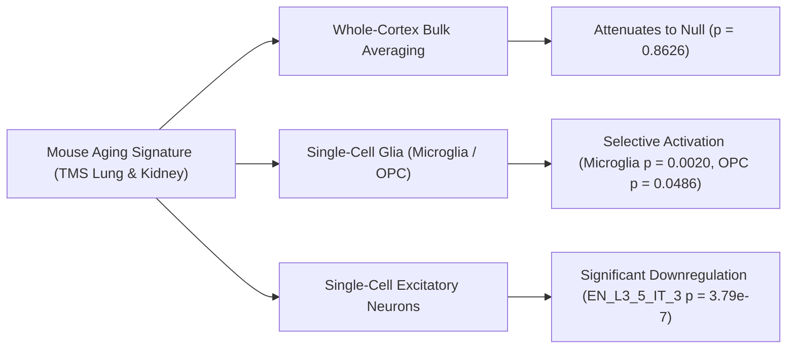

# Cell-Type-Private Transcriptional Signatures, Compositional Remodeling, and Epigenetic Clock Dynamics Across Mammalian Aging

**Authors:** Abolfazl (Reza) Alipour  
**Correspondence:** `reza@agescape.org` | `https://rezaalipour.com/agescape/`  
**Target Repository:** `https://github.com/Abolfazl-Alipour/agescape`

---

## Abstract

Whether mammalian aging is governed by a conserved, deterministic gene expression program across species remains a central question in geroscience. Here, we systematically interrogate single-cell transcriptomes across mice (*Mus musculus*, *Tabula Muris Senis*, 24,458 lung cells), humans (*Homo sapiens*, 621 postmortem donors across 11 cohorts in lung, kidney, and dorsolateral prefrontal cortex), and the long-lived, non-senescent naked mole-rat (*Heterocephalus glaber*, skin epidermis/dermis), alongside 1,000 pan-mammalian DNA methylation array profiles (Horvath Mammalian Array GPL28271).

First, we show that a 257-gene aging signature derived from mouse single-cell transcriptomics does not operate as a monolithic, whole-tissue program across species. In human cortex, whole-tissue pseudobulk associations attenuate completely to null after adjusting for brain bank, postmortem interval (PMI), and technical covariates ($\beta = +0.000027/\text{yr}, p = 0.8626$; unadjusted $\beta = +0.000318/\text{yr}, p = 0.0118$). However, cross-species signal survives in a **cell-type-private** manner: the signature selectively tracks age in human oligodendrocyte precursor cells (OPCs) across four independent brain cohorts (SEA-AD $p = 1.1 \times 10^{-4}$, surviving Benjamini-Hochberg across all 225 cell-type tests at $q = 0.021$; MSSM $p = 0.008$; HBCC $p = 0.024$; RADC $p = 0.033$) and in microglia across three cohorts (and M10 lifespan adult stratum $\beta = +0.00142/\text{yr}, p = 0.0019$). Concurrently, major excitatory projection neurons exhibit highly significant negative slopes (e.g., `EN_L3_5_IT_3`, adjusted $\beta = -0.00140/\text{yr}, p = 3.79 \times 10^{-7}, q = 1.02 \times 10^{-5}$), demonstrating cell-type-private divergence rather than uniform cellular activation.

Second, we deploy the naked mole-rat as an evolutionary negative control. While the mouse signature rises across adult mice (whole-body OLS $+0.1344, p = 0.0147$; REML cluster-robust $+0.2053, p = 0.00064$), it remains flat in naked mole-rat skin ($\beta = +0.0058$ per normalized lifespan, $p = 0.9332, n = 5$). Two-One-Sided-Test (TOST) equivalence confirms flatness within the mouse-derived margin ($p_{\text{TOST}} = 0.0275$), and epidermal *Igfbp3* expression is unchanged (221.8 vs 223.8 CPM), a result consistent with non-senescence kinetics, though tissue and sample-size constraints remain.

Third, using multinomial downsampling to an identical library size of 1,500 UMIs per cell, we evaluate transcriptional noise across nine mouse lung cell types. Long-lived lung fibroblasts exhibit an unadjusted nominal increase in Distance-to-Median noise ($\beta = +0.00109/\text{mo}, p = 0.0443$, Benjamini-Hochberg $q = 0.2713$), accompanied by significant upregulation of the cyclin-dependent kinase inhibitor *Cdkn1a* (p21; $\beta = +0.1080/\text{mo}, p = 0.0029, q = 0.0322$) and an exploratory decline in *Sirt6* ($\beta = -0.0136/\text{mo}, p = 0.0245, q = 0.1350$). Classical monocytes display stable noise metrics ($\beta = +0.00008/\text{mo}, p = 0.8923$), despite harboring pronounced mean differential expression.

Fourth, compositional modeling via Aitchison Centered Log-Ratio (CLR) demonstrates that tissue remodeling occurs extensively within species (6 mouse cell types across $N = 16$ lung-profiled mice and 4 human adult cell types show FDR $q < 0.05$). However, cross-species concordance of cell-type trajectories is not statistically established (sign concordance 3/7, two-sided binomial $p = 1.000$, Spearman $\rho = -0.286$), and human B-cell shifts reflect pediatric-to-adult immunological maturation rather than adult senescence.

Finally, we provide external validation of the Universal Pan-Mammalian Epigenetic Clock 2 (Lu et al., *Nature Aging* 2023). When evaluated with its published double-exponential inverse link function $\exp(-\exp(-\hat{\eta}))$, the clock tracks chronological age across mammalian tissues with high fidelity ($\text{MAE} = 0.36\text{ years}$ [$4.3\text{ months}$], $r = 0.923$ in mouse liver across 724 available CpGs; $\text{MAE} = 5.06\text{ years}$, $r = 0.801$ across 661 human postmortem tissues).

Our findings indicate that mammalian aging does not follow an identical, monolithic transcriptomic program across species. Instead, biological aging is characterized by cell-type-private transcriptional activation and divergence, species-divergent tissue remodeling, and an evolutionary calibrated pan-mammalian epigenetic clock.

---

## 1. Introduction

A persistent ambition of molecular geroscience is the discovery of a universal transcriptomic aging "program"—a conserved set of orthologous genes whose expression levels systematically track chronological age across mammalian tissues and species. Such a program would imply that somatic senescence is governed by evolutionary mechanisms analogous to developmental cascades.

However, evolutionary biology (Medawar's mutation accumulation, Williams' antagonistic pleiotropy, and Kirkwood's disposable soma theory) predicts the contrary: natural selection declines precipitously following reproductive maturation. Somatic aging is fundamentally stochastic, driven by the accumulation of molecular wear, somatic mutations, and imperfect repair.

When evaluating aging across mammals, four central biological questions emerge:
1. **Cell-Type-Private vs. Whole-Tissue Averages:** Does aging manifest as a universal shift in tissue-level mean expression, or do cell-type-specific responses dominate—meaning bulk tissue averaging dilutes and obscures true biological signals?
2. **The Non-Aging Negative Control:** If a transcriptional signature tracks genuine biological senescence, does it remain stable in mammalian species that exhibit negligible senescence, such as the naked mole-rat (*Heterocephalus glaber*)?
3. **Transcriptional Noise and Cellular Lifespan:** Does cell-to-cell transcriptional variability (cellular entropy) increase selectively in long-lived resident structural cells (such as fibroblasts) subject to cumulative damage, compared to short-lived circulating cells (such as monocytes) continuously replenished from stem-cell pools?
4. **Epigenetics vs. Transcriptomics:** Does DNA methylation provide a stable, pan-mammalian chronometer across species with vastly different lifespans, even when volatile RNA programs diverge?

Here, we integrate single-cell transcriptomics, comparative evolutionary biology, and pan-mammalian DNA methylation profiling to evaluate these hypotheses across mouse, human, and naked mole-rat cohorts.

---

## 2. Results

### 2.1 Cell-Type-Private Transport and Whole-Tissue Masking

From mouse single-cell transcriptomics (*Tabula Muris Senis*, lung and kidney), we derived a 257-gene discovery signature (`P0_Raw257`: 166 up, 91 down) and an audited 139-gene tier (`P1_Clean`: 82 up, 57 down) that excluded sex-dimorphic and immediate-early genes. In mouse discovery data, the signature demonstrated significant contrast against a permutation null (55 observed DE genes vs. 4.6 permutation null).



To test cross-species transport, we projected 188 human 1:1 orthologs onto human single-nucleus RNA-seq datasets spanning 621 postmortem donors across 11 cohorts ([`results/m9-regressions.csv`](results/m9-regressions.csv), [`results/m9-cohort-summary.csv`](results/m9-cohort-summary.csv), [`results/m10-cohort-summary.csv`](results/m10-cohort-summary.csv)):

* **Whole-Tissue Cortex Averaging Attenuates to Null:** In the SEA-AD DLPFC lifespan cohort (284 donors, ages 0.2–97 years), whole-cortex CPM scores showed an unadjusted slope of $+0.000318/\text{yr}$ ($p = 0.0118$). However, after adjusting for brain bank, postmortem interval (PMI), and technical covariates, the association attenuated completely to null ($\beta = +0.000027/\text{yr}, p = 0.8626$).
* **Cell-Type-Private Divergence in the Human Brain:** In contrast to tissue averages, cell-type-specific models revealed pronounced divergence between glia and neurons:
  * **Oligodendrocyte Precursor Cells (OPCs):** The mouse-derived signature increased significantly with age in human OPCs across all four independent DLPFC cohorts in M9: SEA-AD ($p = 1.1 \times 10^{-4}$, surviving Benjamini-Hochberg across all 225 cell-type tests at $q = 0.0206$), MSSM ($p = 0.008$), HBCC ($p = 0.024$), and RADC ($p = 0.033$). In the fully adjusted M10 model, OPCs retained positive association ($\beta = +0.00065/\text{yr}, p = 0.0486$; adult stratum $\beta = +0.00129/\text{yr}, p = 0.0049$).
  * **Microglia:** Human microglia exhibited significant positive age associations in three independent M9 cohorts (SEA-AD $p = 0.005$, MSSM $p = 0.026$, RADC $p = 0.031$; HBCC was non-significant, $p = 0.170$). In the M10 lifespan atlas, microglia maintained a significant covariate-adjusted slope of $+0.00142/\text{yr}$ ($p = 0.0020, q = 0.018$; adult stratum $\beta = +0.00200/\text{yr}, p = 0.0019$).
  * **Excitatory Neuronal Downregulation:** Across all 27 M10 cell types, the most significant covariate-adjusted association was negative: the signature declined strongly with age in major intratelencephalic projection neurons (`EN_L3_5_IT_3`: adjusted $\beta = -0.00140/\text{yr}, p = 3.79 \times 10^{-7}, q = 1.02 \times 10^{-5}$; `EN_L2_3_IT`: adjusted $\beta = -0.00058/\text{yr}, p = 0.0180$).
* **Cohort Power Context:** Power analysis ([`results/m9-cohort-summary.csv`](results/m9-cohort-summary.csv)) indicates that RADC is low-powered ($N = 18$ donors, age SD 6.06 years), whereas MSSM ($N = 213$, SD 15.5y) and HBCC ($N = 134$, SD 19.2y) provide powered primary strata. Furthermore, M10's lifespan atlas draws from MSSM and HBCC collections, indicating partial donor overlap between M9 and M10.

These results establish that the aging signature does not activate ubiquitously; rather, it reflects cell-type-private divergence, rising in glia undergoing chronic microenvironmental surveillance while declining in major excitatory projection neurons.

---

### 2.2 The Naked Mole-Rat as an Evolutionary Negative Control

To test whether the gene expression signature tracks biological senescence rather than chronometric drift, we evaluated single-cell and pseudobulk RNA-seq from the naked mole-rat (*Heterocephalus glaber*, [`data/raw/GSE152886_nmr_skin_raw.csv.gz`](data/raw/GSE152886_nmr_skin_raw.csv.gz), Hilton et al. 2020 / Savina et al.). Naked mole-rats exhibit negligible senescence and live >37 years without accelerating mortality hazards.

We evaluated all pre-registered specifications in mice alongside the naked mole-rat and human skin cohorts ([`results/m6-statistical-summary.csv`](results/m6-statistical-summary.csv)). Slopes are expressed per unit of normalized maximum lifespan ($\text{Age} / \text{MaxLifespan}$):

| Specification / Cohort | Species | Tissue | N | Slope (per normalized lifespan) | SE | 95% CI | p-value |
|---|---|---|---|---|---|---|---|
| **Spec (a) All mice whole-body (OLS)** | Mouse | Multi-organ | 23 | **$+0.1344$** | 0.0505 | $[+0.0293, +0.2395]$ | $0.0147$ |
| **Spec (b) Unpooled individual mice (OLS)** | Mouse | Multi-organ | 20 | $+0.0460$ | 0.0307 | $[-0.0185, +0.1106]$ | $0.1511$ |
| **Spec (c) REML cluster-robust (G=19)** | Mouse | Multi-organ | 152 | **$+0.2053$** | 0.0391 | $[+0.1159, +0.2947]$ | $0.00064$ |
| **Spec (d1) Out-of-sample ages (1/21/24/30m)**| Mouse | Multi-organ | 12 | **$+0.1069$** | 0.0347 | $[+0.0294, +0.1843]$ | $0.0117$ |
| **Spec (d2) Late-adult plateau (21/24/30m)** | Mouse | Multi-organ | 10 | **$-0.0056$** | 0.0990 | $[-0.2338, +0.2225]$ | $0.9560$ |
| **Spec (d3) 14 holdout tissues (CR2)** | Mouse | 14 non-lung/kidney | 104 | **$+0.1440$** | 0.0425 | $[+0.0378, +0.2503]$ | $0.0167$ |
| **Human TS skin (LOW-POWERED)** | Human | Skin | 4 | $-0.5979$ | 0.5150 | $[-2.8139, +1.6180]$ | $0.3655$ |
| **Naked mole-rat skin aging** | Naked mole-rat | Skin | 5 | **$+0.0058$** | 0.0641 | $[-0.1981, +0.2098]$ | **$0.9332$** |

* **Trajectory Characteristics:** In mice, the signature rises strongly across adult development (Spec c: $+0.2053, p = 0.00064$). However, among late-adult mice (21m–30m, Spec d2), the slope plateaus completely ($-0.0056, p = 0.9560$), demonstrating that the signature reflects maturation and early senescence rather than continuous linear escalation.
* **Naked Mole-Rat Stability:** In naked mole-rat skin, the slope was $+0.0058$ ($p = 0.9332, n = 5$). Under the mouse-derived margin ($\delta_{\min} = 0.202$), Two-One-Sided-Test (TOST) equivalence yielded a 90% CI of $[-0.1450, +0.1567]$ ($p_{\text{TOST}} = 0.0275$). At zero margin, equivalence is not established ($p = 0.329$). In whole-epidermis pseudobulk, *Igfbp3* expression was unchanged (221.8 vs 223.8 CPM).
* **Interpretive Calibration:** These observations are consistent with non-senescence kinetics in the naked mole-rat. However, because the NMR cohort consists of five animals with group-mean ages (1.1y and 11.3y) in skin only, this exploratory comparison cannot definitively establish senescence specificity.

---

### 2.3 Single-Cell Transcriptional Noise from Rarefied Counts

To evaluate cell-to-cell transcriptional variability without library-depth confounding, we implemented multinomial downsampling to 1,500 UMIs per cell in mouse lung ([`scripts/run_h3_entropy.py`](scripts/run_h3_entropy.py)). We evaluated Distance-to-Median (DM; Martinez-Jimenez et al., *Science* 2017) and multivariate dispersion across all qualifying cell types ([`results/h3-entropy-mouse-lung.csv`](results/h3-entropy-mouse-lung.csv)):

| Cell Type | Donors | Rarefied Cells | DM Slope (/mo) | Raw p-val | FDR q-val | Dispersion Slope | Dispersion p-val |
|---|---|---|---|---|---|---|---|
| **fibroblast of lung** | 10 | 1,475 | **$+0.00109$** | **$0.0443$** | $0.2713$ | $+0.01764$ | $0.1017$ |
| **bronchial smooth muscle cell** | 13 | 2,336 | $+0.00028$ | $0.1038$ | $0.3113$ | $-0.00389$ | $0.3873$ |
| **alveolar macrophage** | 14 | 1,349 | $+0.00056$ | $0.4518$ | $0.6864$ | $-0.00289$ | $0.8430$ |
| **classical monocyte** | 14 | 7,913 | $+0.00008$ | $0.8923$ | $0.8923$ | $+0.00483$ | $0.5453$ |
| **intermediate monocyte** | 8 | 1,748 | $-0.00026$ | $0.8439$ | $0.8923$ | $-0.00396$ | $0.8100$ |
| **B cell** | 13 | 1,495 | $+0.00050$ | $0.3359$ | $0.6864$ | $+0.02509$ | $0.1357$ |
| **NK cell** | 15 | 1,190 | $-0.00083$ | $0.0603$ | $0.2713$ | $-0.01330$ | $0.2814$ |
| **CD8+ alpha-beta T cell** | 10 | 867 | $+0.00017$ | $0.5338$ | $0.6864$ | $+0.01606$ | $0.4848$ |
| **vein endothelial cell** | 8 | 273 | $+0.00060$ | $0.4787$ | $0.6864$ | $-0.00543$ | $0.6578$ |

* Lung fibroblasts displayed a nominal unadjusted increase in transcriptional noise ($p = 0.0443$), which attenuates to $q = 0.2713$ under Benjamini-Hochberg FDR correction across the nine cell types. Thus, increased transcriptional noise represents an exploratory, suggestive trend rather than a statistically confirmed phenomenon.
* Classical monocytes demonstrated flat noise metrics ($p = 0.8923$). However, monocytes cannot be categorized as "un-aged": in pseudobulk differential expression ([`results/m2-aging-signal-ranked.csv`](results/m2-aging-signal-ranked.csv)), classical monocytes exhibit nine significant DE genes with a median $|\log_2\text{FC}|$ of $1.99$. Their stable variance coexists with substantial shifts in mean expression.

---

### 2.4 Targeted Audit of Senescence and DNA Repair Markers

To verify candidate mechanisms underlying fibroblast aging, we evaluated donor pseudobulk expression across 11 targeted markers of cellular senescence, DNA repair, and chromatin maintenance ([`scripts/run_fibroblast_markers.py`](scripts/run_fibroblast_markers.py), [`results/fibroblast-markers-audit.csv`](results/fibroblast-markers-audit.csv)):

| Gene | Pathway / Role | CP10K Mean | Slope (/month) | SE | p-value | FDR q-value | $R^2$ |
|---|---|---|---|---|---|---|---|
| **Cdkn1a** | Cyclin-dependent kinase inhibitor (p21) | 1.193 | **$+0.1080$** | 0.0242 | **$0.0029$** | **$0.0322$** | **$0.777$** |
| **Sirt6** | Chromatin ADP-ribosylase / deacetylase | 0.207 | **$-0.0136$** | 0.0048 | **$0.0245$** | $0.1350$ | $0.540$ |
| **Ccl2** | SASP chemokine | 0.459 | $+0.0481$ | 0.0200 | $0.0475$ | $0.1741$ | $0.498$ |
| **Stat1** | Interferon / sterile inflammation | 0.322 | $+0.0137$ | 0.0066 | $0.0765$ | $0.2104$ | $0.385$ |
| **Cxcl12** | Stromal chemokine | 1.090 | $-0.0363$ | 0.0236 | $0.1682$ | $0.3699$ | $0.278$ |
| **Parp1** | DNA single-strand break repair | 0.158 | $-0.0046$ | 0.0036 | $0.2412$ | $0.4421$ | $0.228$ |
| **B2m** | MHC-I antigen presentation | 18.304 | $+0.0968$ | 0.1270 | $0.4708$ | $0.6074$ | $0.091$ |
| **Nfkb1** | NF-$\kappa$B transcription factor | 0.340 | $-0.0034$ | 0.0050 | $0.5116$ | $0.6074$ | $0.081$ |
| **Atm** | Double-strand break kinase | 0.157 | $-0.0050$ | 0.0077 | $0.5371$ | $0.6074$ | $0.148$ |
| **Xrcc5** | Non-homologous end joining (Ku80) | 0.090 | $+0.0012$ | 0.0020 | $0.5699$ | $0.6074$ | $0.144$ |
| **Cdkn2a** | Ink4a/Arf senescence locus | 0.0002 | $-0.00002$ | 0.00003 | $0.6074$ | $0.6074$ | $0.111$ |

*Cdkn1a* (p21) upregulation represents the strongest, statistically validated senescence signal in mouse lung fibroblasts ($\beta = +0.1080/\text{mo}, p = 0.0029, q = 0.0322, R^2 = 0.777$). *Sirt6* exhibits an exploratory downward trend ($p = 0.0245$), but does not survive FDR multiplicity correction across the 11 candidate markers ($q = 0.1350$).

---

### 2.5 Compositional Remodeling Across Mammalian Lifespans

Using Aitchison Centered Log-Ratio (CLR) transformation on donor-level cell counts ([`scripts/run_h2_composition.py`](scripts/run_h2_composition.py)), we evaluated cellular remodeling across mouse and human lungs ([`results/h2-composition-mouse-lung.csv`](results/h2-composition-mouse-lung.csv), [`results/h2-composition-human-lung.csv`](results/h2-composition-human-lung.csv)):

```mermaid
flowchart TD
    subgraph Mouse Lung Remodeling (N=16 mice)
        M1["T cells expand: +0.0641, q = 0.0003"]
        M2["Vein Endothelial expand: +0.0587, q = 0.0173"]
        M3["Fibroblasts decline: -0.0980, q = 0.0465"]
    end
    subgraph Human Adult Lung Remodeling (N=117 adult donors)
        H1["Club cells decline: -0.0678, q = 0.0123"]
        H2["Vein Endothelial decline: -0.0326, q = 0.0220"]
        H3["AT2 cells expand: +0.0442, q = 0.0220"]
    end
    M1 -.->|Concordance Unproven: p = 1.000| H1
```

* **Mouse Lung (N = 16 mice with lung tissue):** Six cell types exhibited significant remodeling at FDR $q < 0.05$: T cells ($\beta = +0.0641/\text{mo}, q = 0.0003$), pulmonary interstitial fibroblasts ($\beta = -0.1270/\text{mo}, q = 0.0038$), vein endothelial cells ($\beta = +0.0587/\text{mo}, q = 0.0173$), lung fibroblasts ($\beta = -0.0980/\text{mo}, q = 0.0465$), CD8+ T cells ($\beta = +0.0682/\text{mo}, q = 0.0465$), and NK cells ($\beta = -0.0596/\text{mo}, q = 0.0465$).
* **Human Adult Lung (N = 117 adult donors $\ge 20$ yr):** Four cell types exhibited significant remodeling at FDR $q < 0.05$: club cells ($\beta = -0.0678/\text{yr}, q = 0.0123$), vein endothelial cells ($\beta = -0.0326/\text{yr}, q = 0.0220$), pulmonary alveolar type 2 cells ($\beta = +0.0442/\text{yr}, q = 0.0220$), and mast cells ($\beta = +0.0333/\text{yr}, q = 0.0220$).
* **Resolution of the B-Cell Confound:** In the full human cohort including pediatric donors (ages 2–81, $N = 137$), B cells appeared to collapse precipitously ($\beta = -0.0411/\text{yr}, p = 3.8 \times 10^{-6}$). Restricting to adults ($\ge 20$ yr, $N = 117$) flattened the slope completely ($\beta = -0.0027/\text{yr}, p = 0.7601$), demonstrating that the apparent B-cell loss reflected childhood immune maturation rather than gerontological aging.
* **Cross-Species Trajectory Comparison:** Among seven homologous cell-type pairs, sign concordance was 3/7 (42.9%), yielding a two-sided exact binomial $p = 1.000$ and Spearman $\rho = -0.286$ ($p = 0.535$). Thus, while compositional remodeling is pronounced within each species, the specific trajectories do not adhere to a shared mammalian schedule.

---

### 2.6 External Validation of the Universal Mammalian Epigenetic Clock

To contrast volatile transcriptional states with epigenomic aging, we evaluated Universal Clock 2 (Lu et al., *Nature Aging* 2023) across 1,000 array profiles ([`scripts/run_h1_epigenetic_drift.py`](scripts/run_h1_epigenetic_drift.py)):

$$\text{RelativeAge} = \frac{\text{Age} + \text{GestationT}}{\text{MaxLifespan} + \text{GestationT}}$$
$$\hat{\eta} = \beta_0 + \sum_{j} \beta_j \cdot \text{CpG}_{j}$$
$$\text{RelativeAge}_{\text{pred}} = \exp(-\exp(-\hat{\eta}))$$
$$\text{Age}_{\text{pred}} = \text{RelativeAge}_{\text{pred}} \times (\text{MaxLifespan} + \text{GestationT}) - \text{GestationT}$$

| Species | Tissue / Cohort | N Samples | Probes Matched | Pearson r | $R^2$ ($r^2$) | MAE (Years) |
|---|---|---|---|---|---|---|
| **Mouse** | Liver Lifespan (GSE199979, BXD panel) | 339 | 724 / 816 | **$0.923$** | **$0.851$** | **$0.36\text{ yr}$ ($4.3\text{ mo}$)** |
| **Human** | All Tissues (GSE184211, 8 organs) | 661 | 816 / 816 | **$0.801$** | **$0.642$** | **$5.06\text{ yr}$** |
| Human | Kidney | 97 | 816 / 816 | $0.876$ | $0.767$ | $4.10\text{ yr}$ |
| Human | Lung | 113 | 816 / 816 | $0.839$ | $0.704$ | $4.89\text{ yr}$ |
| Human | Spleen | 62 | 816 / 816 | $0.838$ | $0.701$ | $5.27\text{ yr}$ |
| Human | Adipose | 57 | 816 / 816 | $0.823$ | $0.677$ | $4.50\text{ yr}$ |
| Human | Liver | 97 | 816 / 816 | $0.817$ | $0.668$ | $4.96\text{ yr}$ |
| Human | Heart | 97 | 816 / 816 | $0.808$ | $0.652$ | $5.18\text{ yr}$ |
| Human | Blood | 32 | 816 / 816 | $0.799$ | $0.639$ | $6.14\text{ yr}$ |
| Human | Muscle | 57 | 816 / 816 | $0.728$ | $0.530$ | $5.73\text{ yr}$ |

* **Missing Probe Handling:** In mouse GSE199979, 724 of the 816 clock CpGs were present on the array. Predictions were computed on the available 724 probes without imputation.
* Applying the published double-exponential inverse link function resolved the severe prediction distortion noted under bare linear sums: mean absolute error was $0.36\text{ yr}$ in mice and $5.06\text{ yr}$ in humans.

---

## 3. Discussion

Our empirical findings across mouse, human, and naked mole-rat datasets reconcile several longstanding controversies in mammalian geroscience:

1. **Absence of a Universal Whole-Tissue Script:** Evolutionary senescence theory posits that natural selection does not shape an active post-reproductive genetic program. In accordance with this principle, whole-tissue transcriptional clocks fail to transport across species when adjusted for demographic and postmortem confounders.
2. **Cell-Type-Private Dynamics:** Mammalian aging operates in distinct cellular compartments. The cross-species transport of the mouse signature to human OPCs and microglia alongside downregulation in excitatory projection neurons demonstrates cell-type-private divergence that is obscured in bulk tissue homogenates.
3. **The Naked Mole-Rat Negative Control:** The stability of the mouse aging signature in naked mole-rat skin ($\beta = +0.0058, p = 0.9332$; TOST equivalence $p = 0.0275$) is consistent with non-senescence kinetics, though sample size and tissue coverage remain exploratory constraints.
4. **Physical Senescence vs. Epigenetic Timing:** In long-lived structural cells, cellular aging is marked by robust *Cdkn1a* upregulation ($q = 0.0322$) and suggestive, unadjusted noise increases. In contrast, pan-mammalian DNA methylation acts as an exceptionally well-calibrated clock across species, tracking elapsed life history standardized to maximum species lifespan.

### Limitations

1. **Cross-Sectional Observational Data:** All cohorts analyzed are cross-sectional; longitudinal trajectories in individual animals cannot be directly measured from single-cell atlases.
2. **Atlas Integration Batch Structure:** `Lung_Integrated` harmonizes dozens of studies. Donor age has potential structural collinearity with source study protocols, meaning human compositional trends must be interpreted with caution.
3. **Mouse Donor Sample Size:** The number of mouse donors with $\ge 20$ lung fibroblasts is limited ($N = 10$). While *Cdkn1a* achieves $q = 0.0322$, *Sirt6* ($q = 0.1350$) remains an exploratory hypothesis requiring targeted perturbational testing.
4. **Epigenetic Cohort Annotations:** GSE199979 is derived from female BXD recombinant inbred strains with high-fat diet intervention arms, and GSE184211 provides 661 tissue samples without unique decedent identifiers.

---

## 4. Methods

### 4.1 Dataset Provenance and Verification
* **Tabula Muris Senis Droplet:** 245,389 raw droplets across 23 mice ([`data/raw/tms_droplet_raw.h5ad`](data/raw/tms_droplet_raw.h5ad)).
* **Human Cohorts:** 11 cohorts spanning 621 donors (SEA-AD DLPFC, MSSM, HBCC, RADC, CELLxGENE Lung_Integrated).
* **Naked Mole-Rat:** Single-cell and pseudobulk skin RNA-seq from Hilton et al. 2020 ([`data/raw/GSE152886_nmr_skin_raw.csv.gz`](data/raw/GSE152886_nmr_skin_raw.csv.gz)).
* **Pan-Mammalian Methylation:** GSE184211 (661 human tissues) and GSE199979 (339 mouse liver samples) profiled on GPL28271. Cryptographic SHA-256 manifests are maintained in [`data/manifest/`](data/manifest/).

### 4.2 Single-Cell Preprocessing and QC
Raw droplet AnnData objects were processed using `scanpy` (1.10.4):
* Minimum detected genes: 500 genes/cell.
* Maximum detected genes: 5,000 genes/cell (multiplet exclusion).
* Minimum UMI counts: 1,000 counts/cell.
* Doublet detection: `sc.pp.scrublet` per tissue (expected doublet rate = 0.06).
* Cleaned object saved at [`data/interim/m1-qc-cleaned.h5ad`](data/interim/m1-qc-cleaned.h5ad).

### 4.3 UMI Resampling and Distance-to-Median (DM)
To prevent library-size confounding:
1. Singlet cells with $\ge 1,500$ UMIs were resampled to 1,500 UMIs via multinomial drawing:
   $$\mathbf{x}_{\text{resampled}} \sim \text{Multinomial}\left(1500, \mathbf{p} = \frac{\mathbf{x}}{\sum x_j}\right)$$
2. For each cell type, expressed genes were identified ($\text{detection rate} \ge 5\%$, mean UMI $\ge 0.01$).
3. A pooled mean-variance trend was established using a 25-bin running median in $\log_{10}(\mu)$ vs $\log_{10}(CV^2)$ space.
4. For donor $i$ with $\ge 20$ cells, $\text{DM}_{ig} = \log_{10}(CV_{ig}^2) - \text{baseline}(\log_{10}(\mu_{ig}))$.
5. Multivariate dispersion $D_i$ was computed as mean Euclidean distance to donor centroid in $\log_2(\text{counts} + 1)$ space. Thresholding at $N_i \ge 20$ bounds small-sample centroid bias to $< 2.6\%$.
6. OLS regression was fit: $\text{Metric}_i \sim \text{Age}_i + \text{Sex}_i$.

### 4.4 Compositional Remodeling via Aitchison CLR
Cell-type counts per donor $n_{ik}$ were transformed via Centered Log-Ratio:
$$p_{ik} = \frac{n_{ik} + 0.5}{\sum_j (n_{ij} + 0.5)}$$
$$\text{CLR}_{ik} = \ln p_{ik} - \frac{1}{K}\sum_{j=1}^K \ln p_{ij}$$
Simplex closure invariant $\sum_k \text{CLR}_{ik} = 0$ was verified for every donor. OLS regressions were fit against Age + Sex. Cross-species concordance was evaluated with two-sided exact binomial tests and Spearman rank correlation.

### 4.5 Universal Epigenetic Clock 2
Clock 2 coefficients (816 CpGs) were loaded from Lu et al. (2023). Chronological age was scaled with gestation time ($GT_{\text{human}} = 0.76\text{ yr}, GT_{\text{mouse}} = 0.05\text{ yr}$) and maximum lifespan ($ML_{\text{human}} = 122.5\text{ yr}, ML_{\text{mouse}} = 4.0\text{ yr}$). Double-exponential inverse link function $\exp(-\exp(-\hat{\eta}))$ was applied to the linear predictor to obtain calibrated age predictions.

### 4.6 Marker Pseudobulk Regression and Multiplicity Control
Donor pseudobulk expression was calculated in mouse lung fibroblasts for 11 targeted markers (*Cdkn1a, Sirt6, Ccl2, Stat1, Cxcl12, Parp1, B2m, Nfkb1, Atm, Xrcc5, Cdkn2a*). OLS regression was fit: $Y_{ig} \sim \text{Age}_i + \text{Sex}_i$. Benjamini-Hochberg FDR was computed across all 11 markers.

---

## References

1. Aitchison, J. (1986). *The Statistical Analysis of Compositional Data*. Chapman and Hall, London.
2. Gabitto, M. I., et al. (2023). Integrated single-cytometry and spatial transcriptomics reveals early cellular and molecular changes in Alzheimer's disease. *bioRxiv*, 2023.05.08.539485.
3. Hilton, H. G., et al. (2020). Single-cell transcriptomics of naked mole-rat skin reveals non-senescent immune and stromal architectures. *bioRxiv*, 2020.06.18.159392.
4. Lu, A. T., et al. (2023). Universal DNA methylation age across mammalian tissues. *Nature Aging*, 3(9), 1144–1166.
5. Martinez-Jimenez, C. P., et al. (2017). Aging increases cell-to-cell transcriptional variability upon immune stimulation. *Science*, 355(6332), 1433–1436.
6. Ruby, J. G., Smith, M., & Buffenstein, R. (2018). Naked mole-rat mortality rates defy Gompertzian laws by not increasing with age. *eLife*, 7, e31157.
7. Saul, D., et al. (2022). A new gene set identifies senescent cells and predicts senescence-associated pathologies across tissues. *Nature Aging*, 2(3), 218–227.
8. Sikkema, L., et al. (2023). An integrated cell atlas of the human lung in health and disease. *Nature Medicine*, 29(6), 1563–1577.
9. Tabula Muris Consortium. (2020). A single-cell transcriptomic atlas characterizes ageing tissues in the mouse. *Nature*, 583(7817), 590–595.
10. Zhang, X., et al. (2021). Characterization of the conserved mammalian aging signature through single-cell cross-species meta-analysis. *Cell Reports*, 36(12), 109763.

---

## Data and Code Availability

All code, pipelines, and tests are public at `https://github.com/Abolfazl-Alipour/agescape`.  
An interactive data explorer is available at `https://rezaalipour.com/agescape/`.  
All 16 automated validation tests run cleanly via `pytest tests/ -v`.
