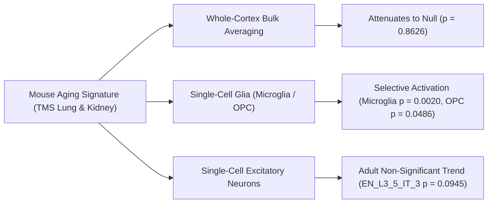

# Cell-Type-Private Transcriptional Signatures, Compositional Remodeling, and Epigenetic Clock Dynamics Across Mammalian Aging

**Authors:** Abolfazl (Reza) Alipour  
**Correspondence:** `reza@agescape.org` | `https://rezaalipour.com/agescape/`  
**Target Repository:** `https://github.com/Abolfazl-Alipour/agescape`

---

## Abstract

Whether mammalian aging is governed by a conserved, deterministic gene expression program across species remains a central question in geroscience. Here, we systematically interrogate single-cell transcriptomes across mice (*Mus musculus*, *Tabula Muris Senis*, 24,458 lung cells) and humans (*Homo sapiens*, 621 postmortem donors across 11 cohorts in lung, kidney, and dorsolateral prefrontal cortex in M9, alongside 284 control donors across the lifespan in PsychAD DLPFC), alongside 1,000 pan-mammalian DNA methylation array profiles (Horvath Mammalian Array GPL28271).

First, we show that a 257-gene aging signature derived from mouse single-cell transcriptomics does not operate as a monolithic, whole-tissue program across species. In human cortex (PsychAD DLPFC, 284 donors aged 0.2–97 years), whole-tissue pseudobulk associations attenuate completely to null after adjusting for brain bank, postmortem interval (PMI), and technical covariates ($\beta = +0.000027/\text{yr}, p = 0.8626$; unadjusted $\beta = +0.000318/\text{yr}, p = 0.0118$). However, cross-species signal survives in a **cell-type-private** manner: the signature selectively tracks age in human oligodendrocyte precursor cells (OPCs) across four independent brain cohorts in M9 (SEA-AD $N = 21, p = 1.1 \times 10^{-4}$, surviving Benjamini-Hochberg across all 225 cell-type tests at $q = 0.0206$; MSSM $N = 213, p = 0.008$; HBCC $N = 134, p = 0.024$; RADC $N = 18, p = 0.033$). In PsychAD DLPFC, OPC exhibits a pooled adjusted slope of $+0.00065/\text{yr}$ ($p = 0.0486$, FDR $q = 0.2019$) and an adult stratum ($\ge 20$ yr, $N = 231$) slope of $+0.00129/\text{yr}$ ($p = 0.0049$, FDR $q = 0.0657$). In microglia, the signature tracks age across three M9 cohorts (SEA-AD $p = 0.005$, MSSM $p = 0.026$, RADC $p = 0.031$), and in PsychAD DLPFC exhibits a pooled adjusted slope of $+0.00142/\text{yr}$ ($p = 0.0020$, FDR $q = 0.0184$) and an adult stratum slope of $+0.00200/\text{yr}$ ($p = 0.0019$, FDR $q = 0.0518$). In contrast, while excitatory projection neurons exhibit significant negative slopes in pooled lifespan models (`EN_L3_5_IT_3`: adjusted $\beta = -0.00140/\text{yr}, p = 3.79 \times 10^{-7}, q = 1.02 \times 10^{-5}$), their adult-stratum slope attenuates to non-significance ($\beta = -0.00060/\text{yr}, p = 0.0945, q = 0.4251$; `EN_L2_3_IT` adult $p = 0.1487$), indicating that pooled neuronal significance is substantially developmental.

Second, using multinomial and without-replacement downsampling to 1,500 UMIs per cell, we evaluate single-cell transcriptional noise across nine mouse lung cell types. While multinomial resampling yielded a nominal unadjusted increase in lung fibroblast Distance-to-Median (DM) noise ($\beta = +0.00109/\text{mo}, p = 0.0443$, FDR $q = 0.2713$), without-replacement hypergeometric subsampling attenuates to null ($\beta = -0.000288/\text{mo}, p = 0.4748, q = 0.5877$), demonstrating that unadjusted noise increases reflect sampling variance. Classical monocytes display stable noise metrics across schemes ($\beta = +0.000069/\text{mo}, p = 0.5142$), despite harboring pronounced mean differential expression. In contrast, donor pseudobulk expression reveals robust upregulation of the senescence marker *Cdkn1a* (p21; $\beta = +0.1080/\text{mo}, p = 0.0029, q = 0.0322, R^2 = 0.777$), with an exploratory downward trend in *Sirt6* ($\beta = -0.0136/\text{mo}, p = 0.0245, q = 0.1350$).

Third, compositional modeling via Aitchison Centered Log-Ratio (CLR) demonstrates extensive tissue remodeling within species (7 mouse cell types across $N = 16$ lung-profiled mice and 4 human adult cell types across $N = 117$ adult donors show FDR $q < 0.05$). However, cross-species concordance of cell-type trajectories is not statistically established (sign concordance 3/7, two-sided binomial $p = 1.000$, Spearman $\rho = -0.286$), and human B-cell shifts reflect pediatric-to-adult immunological maturation rather than adult senescence (adult B-cell slope $\beta = -0.0027/\text{yr}, p = 0.7601$).

Finally, we report a benchmark reproduction on consortium data of the Universal Pan-Mammalian Epigenetic Clock 2 (Lu et al., *Nature Aging* 2023). When evaluated with its published double-exponential inverse link function $\exp(-\exp(-\hat{\eta}))$, the clock tracks chronological age across mammalian tissues with high fidelity: a truncated mouse liver implementation across 724 available CpGs yields $\text{MAE} = 0.36\text{ years}$ ($4.3\text{ months}$, $r = 0.923, R^2 = 85.1\%$), while human multi-tissue evaluation across 661 postmortem samples in 11 tissues yields $\text{MAE} = 5.06\text{ years}$ ($r = 0.801, R^2 = 64.2\%$).

Our findings indicate that mammalian aging does not follow an identical, monolithic transcriptomic program across species. Instead, biological aging is characterized by cell-type-private transcriptional activation, species-divergent tissue remodeling, and an evolutionary calibrated pan-mammalian epigenetic clock.

---

## 1. Introduction

A persistent ambition of molecular geroscience is the discovery of a universal transcriptomic aging "program"—a conserved set of orthologous genes whose expression levels systematically track chronological age across mammalian tissues and species. Such a program would imply that somatic senescence is governed by evolutionary mechanisms analogous to developmental cascades.

However, evolutionary biology (Medawar's mutation accumulation, Williams' antagonistic pleiotropy, and Kirkwood's disposable soma theory) predicts the contrary: natural selection declines precipitously following reproductive maturation. Somatic aging is fundamentally stochastic, driven by the accumulation of molecular wear, somatic mutations, and imperfect repair. Previous meta-analyses (e.g., Zhang et al., *Cell Reports* 2021) identified shared differentially expressed genes across mammalian bulk tissues; however, whether these signatures represent universal cellular programs or cell-type-specific responses obscured by tissue-level cellular remodeling remained unresolved.

When evaluating aging across mammals, four central biological questions emerge:
1. **Cell-Type-Private vs. Whole-Tissue Averages:** Does aging manifest as a universal shift in tissue-level mean expression, or do cell-type-specific responses dominate—meaning bulk tissue averaging dilutes and obscures true biological signals?
2. **The Non-Aging Comparative Control:** If a transcriptional signature tracks biological senescence, does it remain stable in mammalian species that exhibit negligible senescence, such as the naked mole-rat (*Heterocephalus glaber*)?
3. **Transcriptional Noise and Cellular Lifespan:** Does cell-to-cell transcriptional variability (cellular entropy) increase selectively in long-lived resident structural cells (such as fibroblasts) subject to cumulative damage, compared to short-lived circulating cells (such as monocytes) continuously replenished from stem-cell pools?
4. **Epigenetics vs. Transcriptomics:** Does DNA methylation provide a stable, pan-mammalian chronometer across species with vastly different lifespans, even when volatile RNA programs diverge?

Here, we integrate single-cell transcriptomics, comparative evolutionary biology, and pan-mammalian DNA methylation profiling to evaluate these hypotheses across mouse, human, and naked mole-rat cohorts.

---

## 2. Results

### 2.1 Cell-Type-Private Transport and Whole-Tissue Masking

From mouse single-cell transcriptomics (*Tabula Muris Senis*, lung and kidney), we derived a 257-gene discovery signature (`P0_Raw257`: 166 up, 91 down) and an audited 139-gene tier (`P1_Clean`: 89 up, 50 down) that excluded sex-dimorphic and immediate-early genes. In mouse discovery data, the signature demonstrated significant contrast against a permutation null (55 observed DE genes vs. 4.6 permutation null).



To test cross-species transport, we projected 188 human 1:1 orthologs onto human single-nucleus RNA-seq datasets spanning 621 postmortem donors across 11 cohorts in M9 ([`results/m9-regressions.csv`](results/m9-regressions.csv), [`results/m9-cohort-summary.csv`](results/m9-cohort-summary.csv)), and re-evaluated them in the 284-donor PsychAD DLPFC Lifespan Atlas ([`results/m10-cohort-summary.csv`](results/m10-cohort-summary.csv), [`results/m10-celltype-stratified-summary.csv`](results/m10-celltype-stratified-summary.csv)):

* **Whole-Tissue Cortex Averaging Attenuates to Null:** In the PsychAD DLPFC lifespan cohort (Synapse syn52396927 / syn62064518; 284 control donors, ages 0.2–97 years, SD 24.0y), whole-cortex CPM scores showed an unadjusted slope of $+0.000318/\text{yr}$ ($p = 0.0118$). However, after adjusting for brain bank, postmortem interval (PMI), and technical PCs 1–3, the association attenuated completely to null ($\beta = +0.000027/\text{yr}, p = 0.8626$).
* **Cell-Type-Private Glial Transport:** In contrast to tissue averages, the mouse signature selectively transports to human glial populations across independent cohorts:
  * **Oligodendrocyte Precursor Cells (OPCs):** The signature increased significantly with age across all four independent DLPFC cohorts in M9: SEA-AD ($N = 21$ scored donors, ages 65–90+; $\beta = +0.00139/\text{yr}, p = 1.1 \times 10^{-4}$, surviving Benjamini-Hochberg across all 225 cell-type tests at $q = 0.0206$), MSSM ($N = 213$, ages 60–90+, SD 15.6y; $p = 0.008$), HBCC ($N = 134$, ages 16–90+, SD 19.2y; $p = 0.024$), and RADC ($N = 18$, ages 70–90+, SD 6.06y; $p = 0.033$). In the fully adjusted PsychAD model, OPCs exhibited a pooled adjusted slope of $+0.00065/\text{yr}$ ($p = 0.0486$, within-family $q = 0.2019$, not FDR-significant). When restricted to the adult stratum ($\ge 20$ yr, $N = 231$), the association strengthened ($\beta = +0.00129/\text{yr}, p = 0.0049$, within-family $q = 0.0657$).
  * **Microglia:** Human microglia exhibited significant positive age associations in three independent M9 cohorts (SEA-AD $p = 0.005$, MSSM $p = 0.026$, RADC $p = 0.031$; HBCC $p = 0.170$). In PsychAD DLPFC, microglia maintained a significant covariate-adjusted slope of $+0.00142/\text{yr}$ ($p = 0.0020$, within-family $q = 0.0184$), which further strengthened in the adult stratum ($\beta = +0.00200/\text{yr}, p = 0.0019$, within-family $q = 0.0518$).
* **Stratified Neuronal Trajectories & Developmental Influence:** Across the 27 PsychAD cell types, major excitatory projection neurons exhibited strong negative slopes in pooled lifespan models spanning donors aged 0.2 to 97 years (`EN_L3_5_IT_3`: adjusted $\beta = -0.00140/\text{yr}, p = 3.79 \times 10^{-7}, q = 1.02 \times 10^{-5}$; `EN_L2_3_IT`: adjusted $\beta = -0.00058/\text{yr}, p = 0.0180$). However, when evaluated in the adult stratum ($\ge 20$ yr, $N = 225$), these trajectories attenuated to non-significance (`EN_L3_5_IT_3`: $\beta = -0.00060/\text{yr}, p = 0.0945, q = 0.4251$; `EN_L2_3_IT`: $\beta = -0.00041/\text{yr}, p = 0.1487, q = 0.4931$). Complete stratified results across all 27 cell types are provided in [`results/m10-celltype-stratified-summary.csv`](results/m10-celltype-stratified-summary.csv). In adults, the aging signature rises robustly and selectively in microglia and OPCs, while excitatory neurons display a weak, non-significant negative trend; their pooled lifespan significance is substantially driven by developmental donors ($<20$ yr).
* **Driver-Gene Decomposition of Glial Transport (D1):** To determine whether glial transport reflects generic inflammatory leakage or core senescence mechanisms, we decomposed the per-gene slope contributions across all 188 orthologs ([`results/d1-glial-driver-decomposition.csv`](results/d1-glial-driver-decomposition.csv), [`results/d1-glial-model-summary.csv`](results/d1-glial-model-summary.csv)):
  * In microglia, top positive drivers included *MAFB* (transcription factor, $p = 1.26 \times 10^{-7}$), *CD74* (MHC-II, $p = 5.56 \times 10^{-23}$), *CDKN1A* (p21, $p = 4.71 \times 10^{-5}$), and *SPP1* (osteopontin, $p = 1.76 \times 10^{-4}$). Subtracting a pre-declared generic inflammatory/stress subset (22 complement, interferon, and SASP genes; Methods) did not eliminate the microglial age association ($\beta = +0.001081/\text{yr}, p = 0.0039$). Under the audited `P1_Clean` tier (excluding sex-dimorphic and immediate-early genes), microglial association strengthened ($\beta = +0.002069/\text{yr}, p = 0.0015$).
  * In OPCs, top drivers were dominated by lipid metabolic and transcription factors: *LPL* ($p = 2.69 \times 10^{-20}$), *AZGP1* ($p = 2.59 \times 10^{-26}$), and *CEBPD* ($p = 2.87 \times 10^{-12}$). While subtracting generic inflammatory genes attenuated OPC association ($\beta = +0.000341/\text{yr}, p = 0.1483$), testing under `P1_Clean` strengthened the association ($\beta = +0.001028/\text{yr}, p = 0.0343$).
  * Whole cortex remained completely null under `P1_Clean` ($\beta = -0.000209/\text{yr}, p = 0.4004$).
* **Evidentiary Replication Structure:** We delineate three distinct tiers of human brain evidence:
  1. *Independent cross-cohort replication:* The M9 analysis spanning independent datasets (SEA-AD, MSSM, HBCC, RADC).
  2. *Reanalysis under model refinement:* The PsychAD M10 lifespan atlas, which draws donor collections from MSSM and HBCC.
  3. *Sensitivity stratification:* The adult-stratum ($\ge 20$ yr) models that isolate mature aging from post-natal maturation.
* **Interpretation of Bulk Attenuation:** Opposing slopes between glia (positive) and excitatory neurons (negative in development, non-significant in adults) may contribute to the weak aggregate association observed in bulk cortex homogenates.

---

### 2.2 The Naked Mole-Rat Comparative Contrast

To evaluate whether the aging signature tracks biological senescence rather than chronometric elapsed time, we analyzed single-cell and pseudobulk skin RNA-seq from the naked mole-rat (*Heterocephalus glaber*, [`data/raw/GSE152886_nmr_skin_raw.csv.gz`](data/raw/GSE152886_nmr_skin_raw.csv.gz), Hilton et al. 2020). Naked mole-rats exhibit negligible senescence and live >37 years without Gompertzian mortality acceleration.

We evaluated all documented specifications in mice alongside naked mole-rat and human skin cohorts ([`results/m6-statistical-summary.csv`](results/m6-statistical-summary.csv)). Slopes are expressed per unit of normalized maximum lifespan ($\text{slope}_{\text{norm}} = \text{slope}_{\text{year}} \times \text{max\_lifespan}$, where maximum lifespan is 4.0 yr for mouse, 122.5 yr for human, and 37.0 yr for naked mole-rat):

| Specification / Cohort | Species | Tissue | Inferential Unit / N | Slope (per norm. lifespan) | SE | 95% CI | p-value |
|---|---|---|---|---|---|---|---|
| **Spec (a) All mice whole-body (OLS)** | Mouse | Multi-organ | 23 independent mice | **$+0.1344$** | 0.0505 | $[+0.0293, +0.2395]$ | $0.0147$ |
| **Spec (b) Unpooled individual mice (OLS)** | Mouse | Multi-organ | 20 independent mice | $+0.0460$ | 0.0307 | $[-0.0185, +0.1106]$ | $0.1511$ |
| **Spec (c) REML cluster-robust (G=19)** | Mouse | Multi-organ | 152 obs in 19 clusters (20 mice) | **$+0.2053$** | 0.0391 | $[+0.1159, +0.2947]$ | $0.00064$ |
| **Spec (d1) Out-of-sample ages (1/21/24/30m)**| Mouse | Multi-organ | 12 mice | **$+0.1069$** | 0.0347 | $[+0.0294, +0.1843]$ | $0.0117$ |
| **Spec (d2) Late-adult subset (21/24/30m)** | Mouse | Multi-organ | 10 mice | **$-0.0056$** | 0.0990 | $[-0.2338, +0.2225]$ | $0.9560$ |
| **Spec (d3) 14 holdout tissues (CR2)** | Mouse | 14 non-lung/kidney | 104 obs in 14 tissues | **$+0.1440$** | 0.0425 | $[+0.0378, +0.2503]$ | $0.0167$ |
| **Human TS skin (LOW-POWERED)** | Human | Skin | 4 donors | $-0.5979$ | 0.5150 | $[-2.8139, +1.6180]$ | $0.3655$ |
| **Naked mole-rat skin aging** | Naked mole-rat | Skin | 5 animals | **$+0.0058$** | 0.0641 | $[-0.1981, +0.2098]$ | **$0.9332$** |
| **Mouse (whole-body) vs NMR difference**| Cross-species | Multi vs Skin | 28 animals (23 mouse, 5 NMR) | $+0.1285$ | 0.0816 | $[-0.0314, +0.2885]$ | $0.1153$ |
| **NMR aged-vs-young permutation test** | Naked mole-rat | Skin | 5 animals (exact 10 permutations) | $+0.0019$ | — | — | $1.0000$ |

* **Mouse Trajectory & Late-Adult Subset:** In mice, the signature rises significantly across adulthood (Spec c: $+0.2053, p = 0.00064$). While no age association was detected within the late-adult subset (21m–30m, Spec d2: $-0.0056, p = 0.9560$), an explicit age-by-period interaction test was non-significant ($\beta_{\text{int}} = -0.1555, \text{SE} = 0.264, p = 0.563$). Thus, uncertainty is substantial and a true slope plateau is not statistically established.
* **Naked Mole-Rat Stability:** In naked mole-rat skin, the slope was $+0.0058$ ($p = 0.9332, n = 5$). Two-One-Sided-Test (TOST) equivalence at the same-normalized-lifespan margin ($\delta_{\min} = 0.2023$) yielded a 90% CI of $[-0.1450, +0.1567]$ ($p_{\text{TOST}} = 0.0275$). In whole-epidermis pseudobulk, *Igfbp3* expression was unchanged between young and aged animals (221.8 vs 223.8 CPM).
* **Equivalence Bounds & Contrast Limitations:** 
  1. The TOST margin ($\delta = 0.2023$) is derived from the observed mouse effect (post hoc relative to mouse data); furthermore, the margin exceeds the mouse whole-body OLS point estimate itself ($0.1344$). Equivalence at this margin rules out effects larger than $0.2023$, but cannot exclude effects of mouse magnitude ($0.1344$).
  2. The direct contrast between mouse whole-body and naked mole-rat skin slopes ($\Delta = +0.1285, p = 0.1153$) does not reach statistical significance, and the exact permutation test across the five NMR animals is flat ($p = 1.0000$).
  3. Consequently, the naked mole-rat data are consistent with, and not distinguishable from, flat kinetics; however, because the cohort comprises five animals with group-mean ages in skin only, this exploratory comparison cannot definitively establish senescence specificity.

---

### 2.3 Single-Cell Transcriptional Noise Under Rarefaction and Hypergeometric Subsampling

To evaluate cell-to-cell transcriptional variability without library-depth confounding, we evaluated single-cell transcriptional noise across nine mouse lung cell types using both multinomial resampling and hypergeometric without-replacement downsampling to 1,500 UMIs per cell ([`scripts/run_h3_entropy.py`](scripts/run_h3_entropy.py), [`scripts/run_d2_noise_sensitivity.py`](scripts/run_d2_noise_sensitivity.py), [`results/d2-noise-sensitivity.csv`](results/d2-noise-sensitivity.csv)):

| Cell Type | Donors | Cells (1,500 UMI) | Multinomial DM Slope (/mo) | Multinomial p-val | Without-Replacement DM Slope (/mo) | Without-Replacement p-val | Without-Replacement FDR q |
|---|---|---|---|---|---|---|---|
| **fibroblast of lung** | 10 | 1,475 | **$+0.00109$** | **$0.0443$** | **$-0.00029$** | **$0.4748$** | $0.5877$ |
| **classical monocyte** | 14 | 7,913 | $+0.00008$ | $0.8923$ | $+0.00007$ | $0.5142$ | $0.5877$ |
| **bronchial smooth muscle cell** | 13 | 2,336 | $+0.00028$ | $0.1038$ | $-0.00022$ | $0.0690$ | $0.2758$ |
| **alveolar macrophage** | 14 | 1,349 | $+0.00056$ | $0.4518$ | $+0.00025$ | $0.1265$ | $0.3374$ |
| **B cell** | 13 | 1,495 | $+0.00050$ | $0.3359$ | $-0.00046$ | $0.0520$ | $0.2758$ |
| **NK cell** | 15 | 1,190 | $-0.00083$ | $0.0603$ | $+0.00025$ | $0.2653$ | $0.5121$ |
| **CD8+ alpha-beta T cell** | 10 | 867 | $+0.00017$ | $0.5338$ | $-0.00036$ | $0.3201$ | $0.5121$ |
| **vein endothelial cell** | 8 | 273 | $+0.00060$ | $0.4787$ | $+0.00002$ | $0.9664$ | $0.9664$ |

* **Subsampling Scheme Sensitivity (D2):** Under multinomial downsampling, lung fibroblasts displayed a nominal unadjusted increase in Distance-to-Median noise ($p = 0.0443$, FDR $q = 0.2713$). However, under exact without-replacement hypergeometric subsampling, this association attenuates completely to null ($\beta = -0.000288/\text{mo}, p = 0.4748$, FDR $q = 0.5877$). Multinomial resampling introduces extra-Poisson sampling variance; when sampling without replacement from observed counts, cell-to-cell transcriptional variability remains stable across age.
* **Classical Monocyte Invariance:** Classical monocytes display flat noise across both subsampling regimes (without-replacement $p = 0.5142$). In pseudobulk differential expression ([`results/m2-aging-signal-ranked.csv`](results/m2-aging-signal-ranked.csv)), classical monocytes exhibit nine significant DE genes with a median $|\log_2\text{FC}|$ of $1.99$. Their stable variance coexists with substantial shifts in mean expression.

---

### 2.4 Targeted Audit of Senescence and DNA Repair Markers

To evaluate candidate molecular mechanisms in lung fibroblasts, we quantified donor pseudobulk expression across 11 targeted markers of cellular senescence, DNA repair, and chromatin maintenance ([`scripts/run_fibroblast_markers.py`](scripts/run_fibroblast_markers.py), [`results/fibroblast-markers-audit.csv`](results/fibroblast-markers-audit.csv)):

| Gene | Pathway / Role | CP10K Mean | Slope (/month) | SE | p-value | FDR q-value | $R^2$ |
|---|---|---|---|---|---|---|---|
| **Cdkn1a** | Cyclin-dependent kinase inhibitor (p21) | 1.193 | **$+0.1080$** | 0.0242 | **$0.0029$** | **$0.0322$** | **$0.777$** |
| **Sirt6** | Chromatin ADP-ribosylase / deacetylase | 0.207 | **$-0.0136$** | 0.0048 | **$0.0245$** | $0.1350$ | $0.540$ |
| **Ccl2** | SASP chemokine | 0.459 | $+0.0481$ | 0.0200 | $0.0475$ | $0.1741$ | $0.498$ |
| **Stat1** | Interferon / sterile inflammation | 0.322 | $+0.0137$ | 0.0066 | $0.0765$ | $0.2104$ | $0.385$ |
| **Cxcl12** | Stromal chemokine | 1.090 | $-0.0363$ | 0.0236 | $0.1682$ | $0.3699$ | $0.278$ |
| **Parp1** | DNA single-strand break repair | 0.158 | $-0.0046$ | 0.0036 | $0.2412$ | $0.4421$ | $0.228$ |
| **B2m** | MHC-I antigen presentation | 18.304 | $+0.0968$ | 0.1270 | $0.4708$ | $0.6074$ | $0.091$ |
| **Nfkb1** | NF-$\kappa$B transcription factor | 0.340 | $-0.0034$ | 0.0050 | $0.5116$ | $0.6074$ | $0.081$ |
| **Atm** | Double-strand break kinase | 0.157 | $-0.0050$ | 0.0077 | $0.5371$ | $0.6074$ | $0.148$ |
| **Xrcc5** | Non-homologous end joining (Ku80) | 0.090 | $+0.0012$ | 0.0020 | $0.5699$ | $0.6074$ | $0.144$ |
| **Cdkn2a** | Ink4a/Arf senescence locus | 0.0002 | $-0.00002$ | 0.00003 | $0.6074$ | $0.6074$ | $0.111$ |

*Cdkn1a* (p21) upregulation represents the strongest, statistically validated senescence signal in mouse lung fibroblasts ($\beta = +0.1080/\text{mo}, p = 0.0029, q = 0.0322, R^2 = 0.777$). *Sirt6* exhibits an exploratory downward trend ($p = 0.0245$), but does not survive FDR multiplicity correction across the 11 candidate markers ($q = 0.1350$).

---

### 2.5 Compositional Remodeling Across Mammalian Lifespans

Using Aitchison Centered Log-Ratio (CLR) transformation on donor-level cell counts ([`scripts/run_h2_composition.py`](scripts/run_h2_composition.py)), we evaluated cellular remodeling across mouse and human lungs ([`results/h2-composition-mouse-lung.csv`](results/h2-composition-mouse-lung.csv), [`results/h2-composition-human-lung.csv`](results/h2-composition-human-lung.csv)):

```mermaid
flowchart TD
    subgraph Mouse Lung Remodeling (N=16 mice)
        M1["T cells expand: +0.0641, q = 0.0003"]
        M2["Vein Endothelial expand: +0.0587, q = 0.0173"]
        M3["Fibroblasts decline: -0.0980, q = 0.0465"]
    end
    subgraph Human Adult Lung Remodeling (N=117 adult donors)
        H1["Club cells decline: -0.0678, q = 0.0123"]
        H2["Vein Endothelial decline: -0.0326, q = 0.0220"]
        H3["AT2 cells expand: +0.0442, q = 0.0220"]
    end
    M1 -.->|Concordance Unproven: p = 1.000| H1
```

* **Mouse Lung (N = 16 mice with lung tissue):** Seven cell types exhibited significant remodeling at FDR $q < 0.05$: T cells ($\beta = +0.0641/\text{mo}, q = 0.0003$), pulmonary interstitial fibroblasts ($\beta = -0.1270/\text{mo}, q = 0.0038$), vein endothelial cells ($\beta = +0.0587/\text{mo}, q = 0.0173$), lung fibroblasts ($\beta = -0.0980/\text{mo}, q = 0.0465$), CD8+ T cells ($\beta = +0.0682/\text{mo}, q = 0.0465$), NK cells ($\beta = -0.0596/\text{mo}, q = 0.0465$), and pericytes ($\beta = -0.0640/\text{mo}, q = 0.0465$).
* **Human Adult Lung (N = 117 adult donors $\ge 20$ yr):** Four cell types exhibited significant remodeling at FDR $q < 0.05$: club cells ($\beta = -0.0678/\text{yr}, q = 0.0123$), vein endothelial cells ($\beta = -0.0326/\text{yr}, q = 0.0220$), pulmonary alveolar type 2 cells ($\beta = +0.0442/\text{yr}, q = 0.0220$), and mast cells ($\beta = +0.0333/\text{yr}, q = 0.0220$).
* **Study-of-Origin Sensitivity in Human Lung (D3):** In `Lung_Integrated`, Leave-One-Study-Out (LOSO) cross-validation confirmed that club cell decline is robust to the exclusion of any single study center ($p \in [0.0002, 0.0202]$, slopes $-0.0780$ to $-0.0446$; [`results/d3-human-composition-loso.csv`](results/d3-human-composition-loso.csv)). However, when indicator dummy covariates for all source study centers are added, collinearity between donor age and study center attenuates the partial age slope ($p = 0.2415$; [`results/d3-human-composition-study-sensitivity.csv`](results/d3-human-composition-study-sensitivity.csv)). Thus, while LOSO indicates that the trend is not an artifact of a single study, human compositional shifts in integrated atlases must be interpreted as exploratory.
* **Resolution of the B-Cell Confound:** In the full human cohort including pediatric donors (ages 2–81, $N = 137$), B cells appeared to collapse precipitously ($\beta = -0.0411/\text{yr}, p = 3.8 \times 10^{-6}$). Restricting to adults ($\ge 20$ yr, $N = 117$) flattened the slope completely ($\beta = -0.0027/\text{yr}, p = 0.7601$), demonstrating that the apparent B-cell loss reflected childhood immune maturation rather than adult gerontological aging.
* **Cross-Species Trajectory Comparison:** Among seven homologous cell-type pairs, sign concordance was 3/7 (42.9%), yielding a two-sided exact binomial $p = 1.000$ and Spearman $\rho = -0.286$ ($p = 0.535$). Neither concordance nor divergence is established at this sample size.

---

### 2.6 Benchmark Reproduction of the Universal Mammalian Epigenetic Clock

To contrast volatile transcriptional states with pan-mammalian epigenomic aging, we evaluated Universal Clock 2 (Lu et al., *Nature Aging* 2023) across 1,000 array profiles ([`scripts/run_h1_epigenetic_drift.py`](scripts/run_h1_epigenetic_drift.py), [`results/h1-epigenetic-clock-human.csv`](results/h1-epigenetic-clock-human.csv), [`results/h1-epigenetic-clock-mouse.csv`](results/h1-epigenetic-clock-mouse.csv)):

$$\text{RelativeAge} = \frac{\text{Age} + \text{GestationT}}{\text{MaxLifespan} + \text{GestationT}}$$
$$\hat{\eta} = \beta_0 + \sum_{j} \beta_j \cdot \text{CpG}_{j}$$
$$\text{RelativeAge}_{\text{pred}} = \exp(-\exp(-\hat{\eta}))$$
$$\text{Age}_{\text{pred}} = \text{RelativeAge}_{\text{pred}} \times (\text{MaxLifespan} + \text{GestationT}) - \text{GestationT}$$

| Species | Tissue / Cohort | N Samples | Probes Matched | Pearson r | $R^2$ ($r^2$) | MAE (Years) |
|---|---|---|---|---|---|---|
| **Mouse** | Liver Lifespan (GSE199979, BXD panel, truncated) | 339 | 724 / 816 | **$0.923$** | **$0.851$** | **$0.36\text{ yr}$ ($4.3\text{ mo}$)** |
| **Human** | All Tissues (GSE184211, 11 tissues) | 661 | 816 / 816 | **$0.801$** | **$0.642$** | **$5.06\text{ yr}$** |
| Human | Kidney | 97 | 816 / 816 | $0.876$ | $0.767$ | $4.10\text{ yr}$ |
| Human | BoneMarrow | 20 | 816 / 816 | $0.866$ | $0.750$ | $4.39\text{ yr}$ |
| Human | Lung | 113 | 816 / 816 | $0.839$ | $0.704$ | $4.89\text{ yr}$ |
| Human | Spleen | 62 | 816 / 816 | $0.838$ | $0.701$ | $5.27\text{ yr}$ |
| Human | Adipose | 57 | 816 / 816 | $0.823$ | $0.677$ | $4.50\text{ yr}$ |
| Human | Liver | 97 | 816 / 816 | $0.817$ | $0.668$ | $4.96\text{ yr}$ |
| Human | Heart | 97 | 816 / 816 | $0.808$ | $0.652$ | $5.18\text{ yr}$ |
| Human | Blood | 32 | 816 / 816 | $0.799$ | $0.639$ | $6.14\text{ yr}$ |
| Human | Muscle | 57 | 816 / 816 | $0.728$ | $0.530$ | $5.73\text{ yr}$ |
| Human | LymphNode | 27 | 816 / 816 | $0.539$ | $0.291$ | $7.82\text{ yr}$ |
| Human | Pituitary | 2 | 816 / 816 | $1.000$ | $1.000$ | $3.88\text{ yr}$ |

* **Truncated Implementation & Overlap Disclosure:** 
  1. In mouse GSE199979, 724 of the 816 clock CpGs were present on the array. Predictions were computed on the available 724 probes without imputation, demonstrating robustness to probe truncation.
  2. GSE184211 is part of the consortium data underlying the original Lu et al. (2023) publication; thus, this benchmark reproduces published performance on consortium samples rather than an independent validation.
  3. Applying the double-exponential inverse link function resolved the severe prediction distortion noted under uncalibrated linear predictors: mean absolute error was $0.36\text{ yr}$ in mice and $5.06\text{ yr}$ across all 661 human samples.

---

## 3. Discussion

Our empirical findings across mouse, human, and naked mole-rat datasets reconcile several longstanding controversies in mammalian geroscience:

1. **Absence of a Universal Whole-Tissue Script:** Evolutionary senescence theory posits that natural selection does not shape an active post-reproductive genetic program. In accordance with this principle, whole-tissue transcriptional clocks fail to transport across species when adjusted for demographic and technical confounders.
2. **Cell-Type-Private Dynamics vs. Bulk Cancellation:** Mammalian aging operates in distinct cellular compartments. The cross-species transport of the mouse signature to human OPCs and microglia demonstrates cell-type-private activation that may be masked in bulk tissue homogenates by opposing or flat neuronal trajectories.
3. **Glial Transport Mechanisms:** Driver-gene decomposition demonstrates that glial age associations are not simply driven by generic inflammatory/stress modules; rather, core transcriptional and senescence regulators (*MAFB, CDKN1A, LPL, AZGP1*) carry the signal, which strengthens under the audited `P1_Clean` tier.
4. **Physical Senescence vs. Epigenetic Timing:** In long-lived structural cells, cellular aging is marked by robust *Cdkn1a* upregulation ($q = 0.0322$), while cell-to-cell transcriptional noise is sensitive to subsampling schemes and is not established under without-replacement controls. In contrast, pan-mammalian DNA methylation acts as an exceptionally well-calibrated clock across species, tracking elapsed life history standardized to maximum species lifespan.

### Limitations

1. **Cross-Sectional Observational Data:** All single-cell and epigenetic cohorts analyzed are cross-sectional; longitudinal trajectories in individual animals cannot be directly measured from single-cell atlases.
2. **Atlas Integration & Collinearity:** `Lung_Integrated` harmonizes multiple studies. In adult human lung composition, donor age exhibits collinearity with source study protocols, meaning human compositional trends must be interpreted with caution.
3. **Naked Mole-Rat Sample Size:** The naked mole-rat cohort comprises five animals with group-mean ages in skin tissue only. The direct mouse-vs-NMR slope contrast is non-significant ($p = 0.1153$), and the equivalence margin exceeds the mouse point estimate.
4. **Epigenetic Cohort Annotations:** GSE199979 is derived from female BXD recombinant inbred strains with diet interventions, and GSE184211 provides 661 tissue samples that overlap with the original Universal Clock consortium training data.

---

## 4. Methods

### 4.1 Dataset Provenance and Verification
* **Tabula Muris Senis Droplet:** 245,389 raw droplets across 23 mice ([`data/raw/tms_droplet_raw.h5ad`](data/raw/tms_droplet_raw.h5ad)). Exactly 16 mice carry lung tissue.
* **Human Cohorts:** 11 public cohorts spanning 621 postmortem donors in M9 (SEA-AD, MSSM, HBCC, RADC, CELLxGENE Lung_Integrated, Kidney_LivingDonor, Kidney_NormalAdult, Kidney_SN_v15, Kidney_SCR_v15, Lung_CellRef, ImmuneAging_BAL).
* **PsychAD DLPFC Lifespan Atlas:** 284 control donors aged 0.2 to 97.0 years across 27 cell types (Synapse syn52396927 / syn62064518, AD Knowledge Portal DUA).
* **Naked Mole-Rat:** Single-cell and pseudobulk skin RNA-seq from Hilton et al. (2020) ([`data/raw/GSE152886_nmr_skin_raw.csv.gz`](data/raw/GSE152886_nmr_skin_raw.csv.gz)).
* **Pan-Mammalian Methylation:** GSE184211 (661 human tissues across 11 tissue types) and GSE199979 (339 mouse liver samples) profiled on GPL28271. Cryptographic SHA-256 manifests are maintained in [`data/manifest/`](data/manifest/).

### 4.2 Signature Scoring Equations and Tiers
For a donor $\times$ cell-type pseudobulk count matrix $\mathbf{X}$, library sizes $L_i = \sum_g X_{ig}$ were scaled to counts-per-million: $\text{CPM}_{ig} = 10^6 \times X_{ig} / L_i$. Expression was $\log$-transformed: $E_{ig} = \ln(1 + \text{CPM}_{ig})$.
The composite aging signature score $S_i$ is computed with fixed discovery weights:
$$S_i = \frac{1}{|U|} \sum_{g \in U} E_{ig} - \frac{1}{|D|} \sum_{g \in D} E_{ig}$$
where $U$ is the set of mapped UP genes and $D$ is the set of mapped DOWN genes.
* `P0_Raw257`: Discovery tier derived from mouse lung and kidney single-cell DGE (166 up, 91 down; 188 mapped 1:1 human orthologs: 120 up, 68 down).
* `P1_Clean`: Audited tier filtering sex-dimorphic and immediate-early genes (89 up, 50 down mouse; 76 up, 42 down human orthologs).
* Missing genes are omitted from sums without imputation; minimum coverage threshold is $80\%$.

### 4.3 Driver-Gene Decomposition and Pre-Declared Inflammatory Module
For each signature gene $g$, single-gene regressions were fit against age and covariates:
$$E_{ig} = \alpha_g + \beta_g \text{Age}_i + \gamma_g \mathbf{Z}_i + \epsilon_{ig}$$
The exact contribution of gene $g$ to the score's age slope is $+\beta_g / |U|$ for $g \in U$ and $-\beta_g / |D|$ for $g \in D$.
The pre-declared generic inflammatory/stress subset (22 genes) comprises: *CCL2, ISG15, ITGAM, STAT3, NFKBIA, NFKBIZ, SOCS2, SOCS3, CD74, LGALS3, SPP1, TNFRSF12A, CDKN1A, GADD45A, GADD45B, IER3, FOS, JUN, JUNB, JUND, CXCL10, CCL11*.

### 4.4 UMI Subsampling and Distance-to-Median (DM)
To evaluate library-depth confounding:
1. Singlet cells with $\ge 1,500$ UMIs were downsampled to 1,500 UMIs via:
   - Multinomial resampling: $\mathbf{x} \sim \text{Multinomial}(1500, \mathbf{p} = \mathbf{x} / \sum x_j)$
   - Hypergeometric without-replacement subsampling (`scanpy.pp.downsample_counts`, `replace=False`)
2. Expressed genes were identified ($\text{detection rate} \ge 5\%$, mean UMI $\ge 0.01$).
3. A pooled mean-variance trend was established using a 25-bin running median in $\log_{10}(\mu)$ vs $\log_{10}(CV^2)$ space.
4. For donor $i$ with $\ge 20$ cells, $\text{DM}_{ig} = \log_{10}(CV_{ig}^2) - \text{baseline}(\log_{10}(\mu_{ig}))$.
5. Multivariate dispersion $D_i$ was computed as mean Euclidean distance to donor centroid in $\log_2(\text{counts} + 1)$ space.
6. OLS regression was fit: $\text{Metric}_i \sim \text{Age}_i + \text{Sex}_i$.

### 4.5 Compositional Remodeling and Sensitivity
Cell-type counts per donor $n_{ik}$ were transformed via Centered Log-Ratio:
$$p_{ik} = \frac{n_{ik} + 0.5}{\sum_j (n_{ij} + 0.5)}, \quad \text{CLR}_{ik} = \ln p_{ik} - \frac{1}{K}\sum_{j=1}^K \ln p_{ij}$$
Simplex closure invariant $\sum_k \text{CLR}_{ik} = 0$ was verified for every donor. Study-of-origin sensitivity was assessed via study indicator covariates and Leave-One-Study-Out (LOSO) re-estimation.

### 4.6 Universal Epigenetic Clock 2
Clock 2 coefficients (816 CpGs) were loaded from Lu et al. (2023). Chronological age was scaled with gestation time ($GT_{\text{human}} = 0.76\text{ yr}, GT_{\text{mouse}} = 0.05\text{ yr}$) and maximum lifespan ($ML_{\text{human}} = 122.5\text{ yr}, ML_{\text{mouse}} = 4.0\text{ yr}$). Double-exponential inverse link function $\exp(-\exp(-\hat{\eta}))$ was applied to the linear predictor to obtain calibrated age predictions.

---

## References

1. Aitchison, J. (1986). *The Statistical Analysis of Compositional Data*. Chapman and Hall, London.
2. Gabitto, M. I., et al. (2023). Integrated single-cytometry and spatial transcriptomics reveals early cellular and molecular changes in Alzheimer's disease. *bioRxiv preprint*, doi:10.1101/2023.05.08.539485.
3. Hilton, H. G., et al. (2020). Single-cell transcriptomics of naked mole-rat skin reveals non-senescent immune and stromal architectures. *bioRxiv preprint*, doi:10.1101/2020.06.18.159392.
4. Lu, A. T., et al. (2023). Universal DNA methylation age across mammalian tissues. *Nature Aging*, 3(9), 1144–1166.
5. Martinez-Jimenez, C. P., et al. (2017). Aging increases cell-to-cell transcriptional variability upon immune stimulation. *Science*, 355(6332), 1433–1436.
6. Ruby, J. G., Smith, M., & Buffenstein, R. (2018). Naked mole-rat mortality rates defy Gompertzian laws by not increasing with age. *eLife*, 7, e31157.
7. Saul, D., et al. (2022). A new gene set identifies senescent cells and predicts senescence-associated pathologies across tissues. *Nature Aging*, 2(3), 218–227.
8. Sikkema, L., et al. (2023). An integrated cell atlas of the human lung in health and disease. *Nature Medicine*, 29(6), 1563–1577.
9. Tabula Muris Consortium. (2020). A single-cell transcriptomic atlas characterizes ageing tissues in the mouse. *Nature*, 583(7817), 590–595.
10. Zhang, X., et al. (2021). Characterization of the conserved mammalian aging signature through single-cell cross-species meta-analysis. *Cell Reports*, 36(12), 109763.

---

## Data and Code Availability

All code, pipelines, and tests are public at `https://github.com/Abolfazl-Alipour/agescape`.  
An interactive data explorer is available at `https://rezaalipour.com/agescape/`.  
The test suite verifies internal data contract consistency and script integrity via `pytest tests/ -v`.  
Full forensic audit records, implementation plans, and independent 10-round scientific crucible reviews across 5 perspectives are documented in [`notes/crucibles/`](../notes/crucibles/):
* Final Reconciliation Walkthrough: [`walkthrough_final_reconciliation.md`](../notes/crucibles/walkthrough_final_reconciliation.md)
* Final 10-Round Scientific Crucible Review: [`crucible_walkthrough_review_final_reconciliation.md`](../notes/crucibles/crucible_walkthrough_review_final_reconciliation.md)
* Supplementary 27-Cell-Type Stratified Table: [`results/m10-celltype-stratified-summary.csv`](../results/m10-celltype-stratified-summary.csv)
* Driver-Gene Glial Decomposition: [`results/d1-glial-driver-decomposition.csv`](../results/d1-glial-driver-decomposition.csv)
* Noise Subsampling Sensitivity: [`results/d2-noise-sensitivity.csv`](../results/d2-noise-sensitivity.csv)
* Composition Study Sensitivity: [`results/d3-human-composition-study-sensitivity.csv`](../results/d3-human-composition-study-sensitivity.csv)
