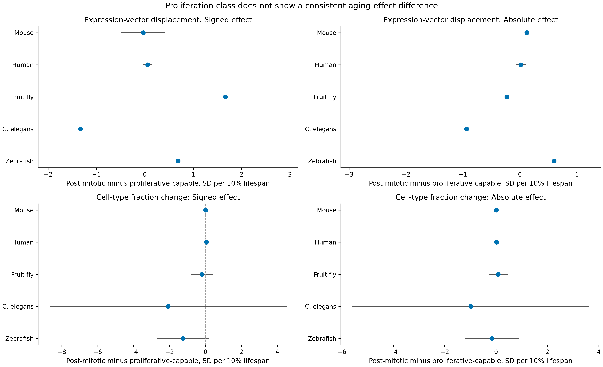

# Does proliferation status explain which cells change with age?

## Bottom line

No consistent proliferation-class effect was found. No overall difference in aging-effect magnitude was detected between post-mitotic and proliferative-capable cells across the tested tissues and species. This result argues against proliferative status as a general explanation for the observed cell-type differences. It does not establish equivalence between groups or test actual cell-turnover rates, which were not measured.

Post-mitotic means that a mature cell has exited the cell cycle and normally does not divide. It differs from quiescence, where a cell can re-enter the cell cycle. The analysis classified the annotated cell itself, not the renewal rate of its tissue. Mixed or uncertain labels and meiotic germ-cell stages were excluded.

## Primary result: effect magnitude

The main comparison is the absolute aging effect, because both increases and decreases in cell fractions matter and expression vectors can move toward or away from the young reference. Effects are in donor-level outcome standard deviations per 10% of species maximum lifespan.

Across all evaluated species and tissue-by-cohort strata containing both classes, the post-mitotic minus proliferative-capable difference was:

- **Cell-type fractions:** -0.0033 SD, 95% CI -0.0743 to +0.0677, HC3 p = 0.9274, within-stratum permutation p = 0.9220. The analysis included 515 units, with 295 proliferative-capable and 220 post-mitotic units.
- **Depth-adjusted expression-vector displacement:** -0.0051 SD, 95% CI -0.1872 to +0.1771, HC3 p = 0.9567, permutation p = 0.9530. The analysis included 231 units, with 113 proliferative-capable and 118 post-mitotic units.

The mammal-only magnitude contrasts were also unresolved: +0.0133 SD for cell fractions, permutation p = 0.5207, and +0.0269 SD for expression vectors, permutation p = 0.2594. The human observed-record-only composition sensitivity gave a mammal-only magnitude contrast of +0.0060 SD, permutation p = 0.7911.

No per-species absolute cell-fraction contrast approached conventional significance after across-species correction. All five per-species permutation p-values for absolute fraction effects were at least 0.2574.

## Species-level results

| Species | Expression units, proliferative vs post-mitotic | Signed expression contrast | Permutation p | Absolute expression contrast | Permutation p |
|---|---:|---:|---:|---:|---:|
| Mouse | 19 vs 2 | -0.0327 | 0.5937 | +0.1200 | 0.0220 |
| Human | 83 vs 32 | +0.0577 | 0.0765 | +0.0167 | 0.5867 |
| Fruit fly | 6 vs 69 | +1.6635 | 0.0195 | -0.2303 | 0.5522 |
| C. elegans | 1 vs 10 | -1.3309 | 0.2729 | -0.9377 | 0.2694 |
| Zebrafish | 4 vs 5 | +0.6860 | 0.0730 | +0.5995 | 0.0810 |

The fly signed contrast passes across-species BH correction, q = 0.0239. It means that post-mitotic cells had more positive signed displacement while several proliferative germline and stem-cell units moved closer to the reference. The absolute fly effect does not differ between groups. This is therefore a difference in direction, not evidence of greater deterioration or greater effect magnitude in post-mitotic cells.

The mouse absolute expression contrast is based on only two post-mitotic units, a kidney podocyte unit and a marrow granulocyte unit. Their signed effects have opposite directions. Two units cannot support a general post-mitotic mechanism. The worm arm has only one proliferative unit, dividing embryonic cells, and is similarly limited. Zebrafish contains only six fish in the fine-grained analysis.

## Cell-fraction results by species

The absolute fraction-effect contrasts were +0.0029 in mouse, +0.0167 in human, +0.0846 in fly, -0.9878 in worm, and -0.1643 in zebrafish. None had permutation p below 0.05. The signs differ, the confidence intervals are wide in the small designs, and the pooled estimate is near zero.

A signed mouse fraction contrast was nominally positive, +0.0124 SD with permutation p = 0.0085, but it did not survive across-species correction, q = 0.0979. Signed fraction slopes can cancel biologically important increases and decreases, so this does not overturn the null magnitude result.

## Bayesian sensitivity analysis

The Bayesian random-effects models account for the standard error of each unit slope and allow additional cell-type heterogeneity. With prior SD 0.5, the depth-adjusted mammalian expression contrast has posterior mean +0.0035 SD and 94% HDI -0.0149 to +0.0211. The all-species expression contrast has posterior mean +0.1694 and 94% HDI -0.0134 to +0.3520. Every all-species depth-adjusted expression HDI crosses zero at prior SDs 0.25, 0.5, and 1.0.

The fly signed expression contrast is prior-sensitive. Its posterior mean is +0.5560 with 94% HDI -0.0823 to +1.2432 at prior SD 0.5, while the interval excludes zero at prior SD 1.0. The depth-adjusted human expression contrast is near zero at every prior, with posterior mean -0.0078 at prior SD 0.5. The mouse and zebrafish intervals also cross zero.

For signed cell-fraction slopes, the all-species Bayesian posterior mean is +0.0138 SD with 94% HDI +0.0041 to +0.0233. The mammal-only mean is +0.0167 with 94% HDI +0.0070 to +0.0262. This is a small direction-of-change contrast, not evidence that post-mitotic cells have larger absolute compositional changes. The frequentist absolute-effect analysis remains null, and the human observed-record-only Bayesian result is centered near zero with its interval crossing zero.

All models had zero divergences. Per-species contrast R-hat values were at most 1.01. Some combined expression models had R-hat up to 1.03 and bulk effective sample sizes near 198, so those combined posterior summaries are secondary and less secure than the per-species models.

## Interpretation

The hypothesis that dividing versus non-dividing status explains why only some cells or organs show aging changes is **not supported as a general rule by these data**. Both groups contain cell types with large and small effects. Post-mitotic neurons can show transcriptional aging, while proliferative-capable immune, epithelial, stromal, and progenitor cells can show either fraction changes, expression changes, both, or neither.

This analysis does not exclude a role for actual proliferation rate, stem-cell replacement, cell death, immune recruitment, or damage persistence. Those are different biological variables. A direct turnover hypothesis requires measurements such as Ki-67 or EdU labeling, lineage tracing, cell birth and death rates, or a validated external turnover annotation. Statistical power, cell recovery, annotation resolution, sequencing depth, and age coverage remain alternative explanations for apparent tissue differences.

## Evidence map

Classification rules and limitations: `notes/proliferation-moderator-methods.md`.

- `results/proliferation-cell-type-classification.csv`
- `results/proliferation-unit-effects.csv`
- `results/proliferation-group-summary.csv`
- `results/proliferation-moderator-tests.csv`
- `results/proliferation-bayesian-posterior.csv`
